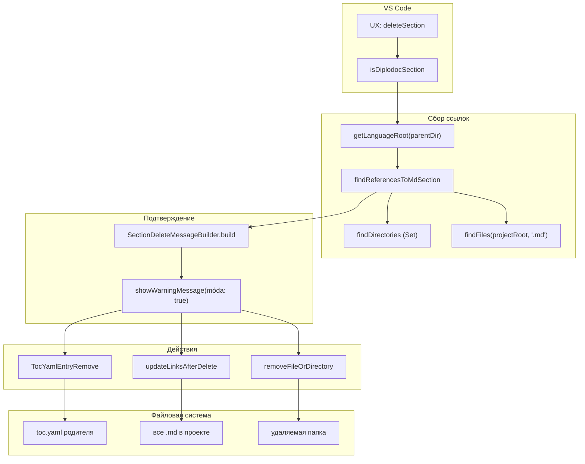
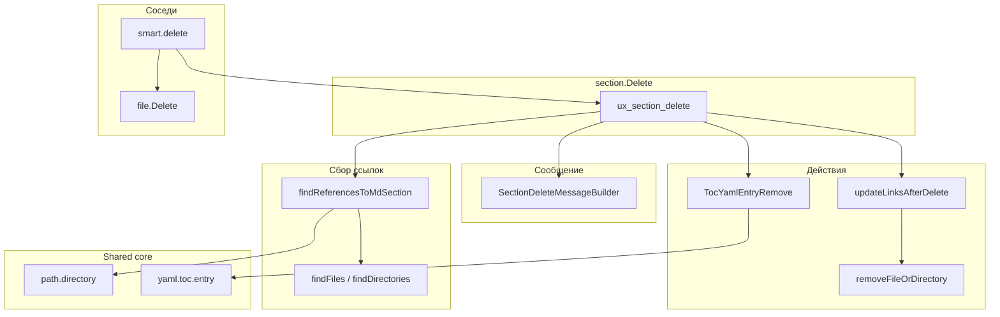

|               |                                                                                                                                                                 |
| ------------- | --------------------------------------------------------------------------------------------------------------------------------------------------------------- |
| ID            | [1.1-024](../../%D0%A1%D0%BE%D0%B3%D0%BB%D0%B0%D1%88%D0%B5%D0%BD%D0%B8%D1%8F/index.md#identifikaciya-modulej)                                                   |
| Идентификатор | `section.Delete`                                                                                                                                                |
| Наименование  | Удаление секции                                                                                                                                                 |
| Слой          | [vscode-ui](../%D0%A1%D0%BB%D0%BE%D0%B8layer/VsCodeUi/index.md#naznachenie) / [pre-processing](../%D0%A1%D0%BB%D0%BE%D0%B8layer/PreProcessing/index.md#naznachenie) |
| Расположение  | `src/commands/diplodoc-helper.section.Delete.js`                                                                                                                |
| Точка входа   | `ux_section_delete(uri)`                                                                                                                                        |
| Версия        | `1.54.0`                                                                                                                                                        |
| Назначение    | Удаляет папку-секцию, чистит запись в родительском `toc.yaml` и заменяет все ссылки на удалённый раздел заглушкой                                               |

{: .page-legend }

## Назначение

`section.Delete` — обратная операция к [`section.Create`](../МодульСозданиесекции/index.md). Пользователь кликает правой кнопкой на папке-секции в Explorer, выбирает **Diplodoc → Удалить секцию**, подтверждает в модальном диалоге — и модуль:

1. **Собирает ссылки на раздел.** Обходит все `.md` в языке и ищет ссылки, которые указывают на удаляемую папку (или её потомков).
2. **Показывает, что будет потеряно.** Модальный диалог с перечнем файлов, где встретятся «мёртвые» ссылки. Пользователь видит, сколько файлов затронуто, и решает — удалять или нет.
3. **Удаляет запись из родительского `toc.yaml`.** Если этого не сделать, `@diplodoc/cli` при сборке упадёт, потому что `toc.yaml` родителя ссылается на несуществующую папку.
4. **Заменяет ссылки на `**удалено**`.** Все `.md`, где встречались ссылки на раздел, получают «заглушку» вместо `[text](…/deleted/index.md)`. Так сборка не падает на битых ссылках.
5. **Удаляет папку.** `fs.rmSync(deletedPath, { recursive: true, force: true })`.

Без модуля для той же операции пришлось бы:

1. Найти все `.md` в проекте, в которых есть ссылки на удаляемый раздел (`grep`/`rg` вручную).
2. Открыть каждый, заменить ссылки вручную.
3. Открыть родительский `toc.yaml`, найти и удалить `items`-запись.
4. Удалить папку.

Особенность: модуль **не** делает операцию «атомарной». Если удаление папки провалится (нет прав, файл занят), запись из `toc.yaml` уже удалена, ссылки уже заменены на `**удалено**`, а раздел — на месте. См. «Известные ограничения».

## Применение

**Когда использовать:** нужно удалить секцию (с подсекциями) — с очисткой `toc.yaml` родителя и заменой ссылок на `**удалено**`.

**Когда НЕ использовать:** удаляется обычный файл/папка (не секция) — используйте `file.Delete`; `toc.yaml` не должен правиться — стандартный `Delete` в VS Code.

**Альтернативы:**
- Стандартный `Delete` в Explorer — оставит «висячую» запись в `toc.yaml` и битые ссылки.
- `file.Delete` — не чистит `toc.yaml` (только если удаляемая папка была секцией).

**Типичный сценарий:** ПКМ на секции → **Diplodoc → Удалить, очищая ссылки** (маршрутизация через `smart.delete`) → модальное подтверждение с числом ссылок → удаление.

## Как это работает



### Фаза 1. Валидация

```js
async function ux_section_delete(uri) {
    if (!uri) return;
    const targetDir = uri.fsPath;
    const folderName = path.basename(targetDir);
    const parentDir = path.dirname(targetDir);

    if (!isDiplodocSection(targetDir)) {
        vscode.window.showWarningMessage(translate(nls_ts.plugin.section.delete.error.incorrectSection));
        return;
    }

    const projectRoot = getLanguageRoot(parentDir);
```

`isDiplodocSection(targetDir)` — папка должна содержать `index.md` + `index.yaml` + `toc.yaml`. Если нет — предупреждение `«Выбранная папка не является разделом Diplodoc. Используйте стандартное удаление.»` и выход.

`getLanguageRoot(parentDir)` — идёт от **родителя** (не от самой папки), чтобы найти `docs/<lang>/`. Для «Раздел1.Введение» в `docs/ru/` — `parentDir = docs/ru`, `getLanguageRoot(docs/ru)` → `docs/ru/`. Для «Подраздел» в `docs/ru/Раздел1/` — `parentDir = docs/ru/Раздел1`, `getLanguageRoot` идёт вверх до `docs/ru/`. Всегда возвращает корень языка.

Если `uri` не передан — тихий `return` (без сообщения). См. «Известные ограничения».

### Фаза 2. Сбор ссылок (`findReferencesToMdSection`)

```js
let references = [];
try {
    references = await findReferencesToMdSection(targetDir, projectRoot);
} catch (err) {
    console.warn('Ошибка поиска ссылок:', err);
}
```

`findReferencesToMdSection(targetFolderPath, projectRoot)` — из `diplodoc-helper.file.md.js`:

1. **`deletedTree = findDirectories(targetFolderPath, '.md')`** — `Set` абсолютных путей всех `.md` внутри удаляемой папки (рекурсивно). Нужен, чтобы быстро проверять `«эта цель — внутри дерева?»`.

2. **`allMdFiles = await findFiles(projectRoot, '.md')`** — все `.md` в языке (`docs/ru/`), кроме папок с `.` в имени.

3. **Для каждого `filePath` в `allMdFiles`:**
   - пропускается, если `isTargetInDeletedTree(filePath, deletedTree, targetFolderPath)` — то есть сам файл внутри удаляемого раздела (не считаем ссылки между статьями удаляемого раздела);
   - читается содержимое, парсится `parseMarkdownLinks(content)` — все `[text](path)` и ``;
   - для каждой ссылки:
     - `isExternalLink(link)` — пропуск (`http`, `#`, `mailto`, `/`);
     - `splitMdPathQueryHash(link.rawPath)` → `pathPart` (без `?query#hash`);
     - `decodeLinkPath(pathPart)` — `decodeURIComponent`;
     - `absoluteTarget = path.resolve(dirname(filePath), decodedPath)`;
     - `isTargetInDeletedTree(absoluteTarget, deletedTree, targetFolderPath)` — если ссылка ведёт на файл в дереве (или на сам `deletedRoot`, если это ссылка на папку) — счётчик `count++`.

4. **Сбор результата:** `{ filePath, relativePath, linkCount }`. Сортировка по `linkCount` убыв.

5. **Возврат** — массив `references`. Если `findFiles` бросил — `console.warn`, возврат `[]`.

`isTargetInDeletedTree(absoluteTarget, deletedTree, deletedRoot)`:

```js
if (deletedTree.has(absoluteTarget)) return true;
return absoluteTarget.startsWith(deletedRoot + path.sep);
```

Вторая ветка — для ссылок на папку (`./foo/` без `/index.md`), когда `absoluteTarget` — сама папка.

### Фаза 3. Подтверждение (`SectionDeleteMessageBuilder`)

```js
let message = new SectionDeleteMessageBuilder(folderName).build(references);

const confirm = await vscode.window.showWarningMessage(
    message,
    { modal: true },
    translate(nls_ts.plugin.section.delete.confirmation.title)
);

if (confirm !== translate(nls_ts.plugin.section.delete.confirmation.title)) return;
```

`SectionDeleteMessageBuilder` (из `vscode.message.builder.js`, наследник `MessageBuilder`):

- **`introduction()`** — `"Удалить раздел «<folderName>» и всё его содержимое безвозвратно?"` (из `plugin.section.delete.confirmation.text`);
- **`header(count)`** — `"Будут удалены ссылки в N файлах:"` (через `crossref.plural.file.message` / `crossref.few.files.message`);
- **`referenceListSlice(references, 12)`** — список до 12 файлов:
  - путь обрезается по центру (`truncateMiddle(cleanedPath, 59)`) — чтобы длинные пути не ломали строку;
  - `index.md` в конце пути обрезается (`cleanedPath = pathStr.replace(/[/\\]index\.md$/i, '')`);
  - `linkCount` — `" (N ссылок)"`;
  - если файлов больше 12 — `"... и ещё N файлов"`;
- **`footer()`** — `"Ссылки внутри удаляемого раздела и его подразделов игнорируются (они удалятся вместе с разделом)."` (из `crossref.footer.message`);
- **`noReferencesMessage()`** — `"В проекте не найдено внешних ссылок на этот раздел."`.

Итоговое сообщение — одно большое текстовое поле в модальном диалоге. Кнопка подтверждения — `«Удалить»` (из `plugin.section.delete.confirmation.title`).

### Фаза 4. Удаление

```js
try {
    TocYamlEntryRemove(parentDir, folderName);
    await updateLinksAfterDelete(references, targetDir, projectRoot, '**удалено**');
    vscode.window.showInformationMessage(translate(nls_ts.plugin.section.delete.info.success, folderName));
} catch (err) {
    let msg = err instanceof Error ? err.message : String(err);
    vscode.window.showErrorMessage(translate(nls_ts.plugin.section.delete.error.critical, msg));
}
```

**Шаг 4.1. `TocYamlEntryRemove(parentDir, folderName)`** — из `yaml.toc.entry.js`:

1. `tocPath = parentDir/toc.yaml`. Если нет — `return` (тихо).
2. `tocData = YAML.parse(fs.readFileSync(tocPath))` → `{ items: [...] }`.
3. `targetHref = folderName + '/index.md'`.
4. `tocData.items = tocData.items.filter(item => item.href !== targetHref)`.
5. `fs.writeFileSync(tocPath, YAML.stringify(tocData))`.

Запись из родителя удаляется. Если по какой-то причине `href` был `folderName/index.yaml` (старый формат) — фильтр не сработает, запись останется. См. «Известные ограничения».

**Шаг 4.2. `updateLinksAfterDelete(references, targetDir, projectRoot, '**удалено**')`** — из `diplodoc-helper.links.md.js`:

```js
async function updateLinksAfterDelete(references, deletedPath, projectRoot, stubText) {
    const isDirectory = fs.statSync(deletedPath).isDirectory();

    if (references.length > 0) {
        if (isDirectory) {
            await updateLinksAfterFolderDelete(deletedPath, projectRoot, stubText);
        } else {
            await updateLinksAfterFileDelete(deletedPath, projectRoot, stubText);
        }
    }
    removeFileOrDirectory(isDirectory, deletedPath);
}
```

- Если `references.length > 0` — `updateLinksAfterFolderDelete`:
  - `deletedTree = findDirectories(deletedPath, '.md')` (ещё раз, заново);
  - `transform = absoluteTarget => isTargetInDeletedTree(...) ? null : undefined`;
  - `updateLinksInProject(projectRoot, transform, stubText)` — обход **всех** `.md` в `projectRoot`:
    - для каждой ссылки, указывающей на удаляемое дерево, `updateLinksInContent` заменяет `[text](…)` на `stubText` (`**удалено**`).
- Если `references.length === 0` — обновление ссылок пропускается (нечего обновлять).
- **`removeFileOrDirectory(isDirectory, deletedPath)`** — всегда, независимо от `references`:
  - папка → `fs.rmSync(deletedPath, { recursive: true, force: true })`;
  - файл → `fs.unlinkSync(deletedPath)`.

`removeFileOrDirectory` с `force: true` **не бросает** исключение при неудаче (нет прав, файл занят). Ошибка проглатывается. См. «Известные ограничения».

**Шаг 4.3. Сообщение.** «Раздел «<folderName>» успешно удалён.»

### Файлы модуля

| Файл                                             | Ответственность                                                                                                                |
| ------------------------------------------------ | ------------------------------------------------------------------------------------------------------------------------------ |
| `src/commands/diplodoc-helper.section.Delete.js` | `ux_section_delete` — оркестратор                                                                                              |
| `src/commands/diplodoc-helper.file.md.js`        | `findReferencesToMdSection`, `findReferencesToMdFile`, `buildMdFileReferences`                                                 |
| `src/commands/diplodoc-helper.files.js`          | `findDirectories`, `findFiles`, `isTargetInDeletedTree`, `removeFileOrDirectory`                                               |
| `src/commands/diplodoc-helper.links.md.js`       | `updateLinksAfterDelete`, `updateLinksAfterFolderDelete`, `updateLinksInProject`, `updateLinksInContent`, `parseMarkdownLinks` |
| `src/commands/vscode.message.builder.js`         | `SectionDeleteMessageBuilder`, базовый `MessageBuilder`                                                                        |
| `src/commands/diplodoc-helper.links.coder.js`    | `decodeLinkPath`, `encodePathSegments`                                                                                         |
| `src/plugins/utils/yaml.toc.entry.js`            | `TocYamlEntryRemove`                                                                                                           |
| `src/plugins/utils/path.directory.js`            | `isDiplodocSection`, `getLanguageRoot`                                                                                         |
| `src/plugins/shared/parser/md/mdLinks.js`        | `isExternalLink`                                                                                                               |

### Формат `references[]`

```js
[
    { filePath: '/abs/path/foo.md', relativePath: 'foo.md', linkCount: 3 },
    { filePath: '/abs/path/bar.md', relativePath: 'bar.md', linkCount: 1 },
]
```

`relativePath` — относительно `projectRoot` (`docs/ru/`). Используется в сообщении.

## Режимы работы

### VS Code

| Команда                         | Заголовок      | Где появляется                                          |
| ------------------------------- | -------------- | ------------------------------------------------------- |
| `diplodoc-helper.deleteSection` | Удалить секцию | Explorer → Diplodoc → Удалить секцию (только на папках) |

Условие появления (`when`): `explorerResourceIsFolder`. Но команда доступна только в **подменю** Diplodoc (не в корне контекстного меню папки). Также есть `diplodoc-helper.smart.delete` — универсальная «Удалить, очищая ссылки», которая сама определяет, что удалять (`section.Delete` или `file.Delete`).

### CLI

CLI-команды нет. Модуль — только VS Code.

### Сборочный пайплайн

В `docs-build.js` не участвует.

## Юнит-тесты





## Связи

`section.Delete` — одна из четырёх команд семейства `sections`, но единственная, которая **удаляет** файлы. Все остальные либо создают, либо переименовывают, либо перемещают.

С другими командами семейства:

| Команда                                                    | Что делает      | Общее с `section.Delete`                                 |
| ---------------------------------------------------------- | --------------- | -------------------------------------------------------- |
| [`section.Create`](../МодульСозданиесекции/index.md)       | Создаёт         | Обратная операция                                        |
| [`section.Rename`](../МодульПереименованиесекции/index.md) | Переименовывает | Использует `TocYamlEntryUpdateOrAppend` (а не `Remove`)  |
| [`section.Move`](../МодульПеремещениесекции/index.md)      | Перемещает      | Использует `TocYamlEntryRemove` **и** `InsertAtPosition` |

С [`sections.core`](../МодульЯдросоцифровок/index.md) — использует только `TocYamlEntryRemove` (одна функция из «ядра»). Вся остальная работа — в `file.md`, `files`, `links.md`, `message.builder`.

С **`smart.delete`** (`src/commands/diplodoc-helper.smart.delete.js`) — обёртка:

```js
if (fs.existsSync(targetPath) && fs.statSync(targetPath).isDirectory() && isDiplodocSection(targetPath)) {
    return ux_section_delete(uri);
}
return ux_file_delete(uri);
```

То есть `smart.delete` — «одна команда для всего»: на папке-секции → `section.Delete`, на файле или не-секции → `file.Delete`. См. будущую статью `smart.delete`.

С **`file.Delete`** (`src/commands/diplodoc-helper.file.Delete.js`) — отдельный модуль. Отличия:

- не проверяет `isDiplodocSection` (может удалить папку без `index.md`);
- не вызывает `TocYamlEntryRemove` (не чистит `toc.yaml` родителя).

Если пользователь через `smart.delete` удалит **не-секцию** (папку без `toc.yaml`), `TocYamlEntryRemove` не вызовется — запись в `toc.yaml` родителя останется. Потом `@diplodoc/cli` будет ругаться на несуществующую папку. См. «Известные ограничения».






