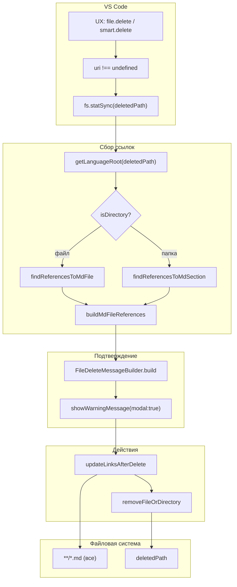

|               |                                                                                                                                                                 |
| ------------- | --------------------------------------------------------------------------------------------------------------------------------------------------------------- |
| ID            | [1.2-039](../../%D0%A1%D0%BE%D0%B3%D0%BB%D0%B0%D1%88%D0%B5%D0%BD%D0%B8%D1%8F/index.md#identifikaciya-modulej)                                                   |
| Идентификатор | `file.Delete`                                                                                                                                                   |
| Наименование  | Удаление файла                                                                                                                                                  |
| Слой          | [pre-processing](../%D0%A1%D0%BB%D0%BE%D0%B8layer/PreProcessing/index.md#naznachenie) / [vscode-ui](../%D0%A1%D0%BB%D0%BE%D0%B8layer/VsCodeUi/index.md#naznachenie) |
| Расположение  | `src/commands/diplodoc-helper.file.Delete.js`                                                                                                                   |
| Точка входа   | `ux_file_delete(uri)`                                                                                                                                           |
| Версия        | `1.54.0`                                                                                                                                                        |
| Назначение    | Удаляет файл или папку (не секцию) и заменяет все ссылки на неё заглушкой `**удалено**`                                                                         |

{: .page-legend }

## Назначение

`file.Delete` — операция «удалить файл или папку с очисткой ссылок». Пользователь кликает правой кнопкой на `.md`-файле или на папке (не-секции) в Explorer, выбирает **Diplodoc → Удалить файл, очищая ссылки** (или это делает `smart.delete` — см. [`smart.delete`](../%D0%A0%D0%B5%D0%B5%D1%81%D1%82%D1%80/%D0%9C%D0%BE%D0%B4%D1%83%D0%BB%D1%8C%D0%A3%D0%BC%D0%BD%D0%BE%D0%B5%D1%83%D0%B4%D0%B0%D0%BB%D0%B5%D0%BD%D0%B8%D0%B5/index.md)) — и модуль:

1. **Собирает ссылки** на удаляемый объект (файл → `findReferencesToMdFile`, папка → `findReferencesToMdSection`).
2. **Показывает подтверждение** с перечнем файлов, где эти ссылки встречаются.
3. **Заменяет ссылки** на `**удалено**` — во всех `.md` проекта.
4. **Удаляет** файл или папку (`fs.unlinkSync` / `fs.rmSync`).

В отличие от [`section.Delete`](../МодульУдалениесекции/index.md), `file.Delete`:

- работает с **любым** файлом или папкой (не только с «секцией» `index.md + index.yaml + toc.yaml`);
- **не** трогает `toc.yaml` родителя — если удаляется запись, на которую ссылались в навигации, `@diplodoc/cli` при следующей сборке упадёт (см. «Известные ограничения»).

Модуль — «низкоуровневый» родственник `section.Delete`. Для «правильного» удаления секции — использовать `section.Delete`. Для файлов и «пустых» папок — `file.Delete`.

 
## Применение

**Когда использовать:** удаляется файл или папка-не-секция, и нужно заменить все markdown-ссылки на них заглушкой `**удалено**` — чтобы `@diplodoc/cli` не упал на битых ссылках.

**Когда НЕ использовать:** удаляется **секция** (`index.md + index.yaml + toc.yaml`) — используйте `section.Delete` (там ещё чистится `toc.yaml` родителя).

**Альтернативы:**
- Стандартный `Delete` в Explorer — битые ссылки останутся.
- `section.Delete` — не работает для файлов/не-секций.

**Типичный сценарий:** ПКМ на файле → **Diplodoc → Удалить, очищая ссылки** (через `smart.delete`) → модальное подтверждение со списком ссылок → удаление + замена на `**удалено**`.

## Как это работает



### Фаза 1. Валидация и определение типа

```js
async function ux_file_delete(uri) {
    if (!uri) return;

    const deletedPath = uri.fsPath;
    const targetName = path.basename(deletedPath);
    const projectRoot = getLanguageRoot(deletedPath);

    const isDirectory = fs.statSync(deletedPath).isDirectory();
    let references = await buildMdFileReferences(deletedPath, projectRoot);
```

- **`uri`** — из контекстного меню Explorer. Если нет (программный вызов) — тихий `return`. См. «Известные ограничения».
- **`projectRoot = getLanguageRoot(deletedPath)`** — корень языка (`docs/ru/` / `docs/en/`). От него строятся все относительные пути в `findFiles` и `updateLinksInProject`.
- **`fs.statSync(deletedPath).isDirectory()`** — определяет тип объекта. `throw` при отсутствии файла (race condition) **не** ловится.
- **`buildMdFileReferences(deletedPath, projectRoot)`** — обёртка из `file.md.js`, выбирает между `findReferencesToMdFile` (для файла) и `findReferencesToMdSection` (для папки).

### Фаза 2. Сбор ссылок

**Для файла — `findReferencesToMdFile(targetFilePath, projectRoot)`:**

1. `allMdFiles = await findFiles(projectRoot, '.md')` — все `.md` в языке (рекурсивно, кроме папок с `.` в имени).
2. Для каждого `filePath`, кроме **самого** `targetFilePath`:
   - читает содержимое, парсит `parseMarkdownLinks(content)` (regex `(!?)\[([^30]]*)\]\(([^31]+)\)`);
   - для каждой ссылки:
     - `isExternalLink` → пропуск (`http://`, `#`, `mailto:`, `/`);
     - `splitMdPathQueryHash(rawPath)` → `pathPart` (без `?query#hash`);
     - `decodeLinkPath` → `decodeURIComponent`;
     - `absoluteTarget = path.resolve(dirname(filePath), decodedPath)`;
     - если `absoluteTarget === targetFilePath` — `count++`.
3. Возврат `[{ filePath, relativePath, linkCount }]`, сортировка по `linkCount` убыв.

**Для папки — `findReferencesToMdSection(targetFolderPath, projectRoot)`:**

1. `deletedTree = findDirectories(targetFolderPath, '.md')` — `Set` всех `.md` внутри удаляемой папки.
2. `allMdFiles` — все `.md` в проекте.
3. Для каждого `filePath`, **не** внутри `deletedTree`:
   - парсит ссылки;
   - для каждой `absoluteTarget`:
     - `isTargetInDeletedTree(absoluteTarget, deletedTree, targetFolderPath)` — `true`, если `absoluteTarget` в `Set` или начинается с `targetFolderPath + sep`.
4. Возврат аналогичный.

**`findFiles`** (из `diplodoc-helper.files.js`):

```js
async function findFiles(dir, extension) {
    const files = [];
    const entries = fs.readdirSync(dir, { withFileTypes: true });
    for (const entry of entries) {
        const fullPath = path.join(dir, entry.name);
        if (entry.isDirectory()) {
            if (!entry.name.startsWith('.')) {
                files.push(...(await findFiles(fullPath, extension)));
            }
        } else if (entry.name.endsWith(extension)) {
            files.push(fullPath);
        }
    }
    return files;
}
```

Рекурсивный обход, пропускает папки с `.` в начале (`.git`, `.vscode`, `_drafts` — если названы с точкой). Для `docs/ru/` это норма — там нет скрытых папок.

**`isTargetInDeletedTree`:**

```js
function isTargetInDeletedTree(absoluteTarget, deletedTree, deletedRoot) {
    if (deletedTree.has(absoluteTarget)) return true;
    return absoluteTarget.startsWith(deletedRoot + path.sep);
}
```

Вторая ветка — для ссылок на **папку** (без `/index.md`), когда `absoluteTarget` — сама папка.

### Фаза 3. Подтверждение

```js
let message = new FileDeleteMessageBuilder(isDirectory, targetName).build(references);

const confirm = await vscode.window.showWarningMessage(message, { modal: true }, 'Удалить');

if (confirm !== 'Удалить') return;
```

`FileDeleteMessageBuilder` (из `vscode.message.builder.js`, наследник `MessageBuilder`):

- **`introduction()`**:
  - для папки: `«Удалить раздел «<name>» и всё его содержимое безвозвратно?»` (переиспользует `plugin.section.delete.confirmation.text`);
  - для файла: `«Удалить файл «<name>»?»` (`crossref.plural.file.confirm.header`).
- **`header(count)`**:
  - `count === 0` → `''`;
  - `count === 1` → `«Будут удалены ссылки в 1 файле:»` (`crossref.plural.file.message`);
  - иначе → `«Будут удалены ссылки в N файлах:»` (`crossref.few.files.message`).
- **`referenceListSlice(references, 12)`** — до 12 файлов:
  - путь обрезается по центру (`truncateMiddle(cleanedPath, 59)`);
  - `index.md` в конце пути обрезается (`cleanedPath = pathStr.replace(/[/\\]index\.md$/i, '')`);
  - `linkCount` — `« (N ссылок)»` (`crossref.plural.links.message` / `crossref.few.links.message`);
  - если больше 12 — `«... и ещё N файлов»` (`crossref.more.files.message`).
- **`footer()`** → `''` (пустой — нет примечания, как у `SectionDeleteMessageBuilder`).
- **`noReferencesMessage()`** → `«Ссылок на этот объект не найдено.»` (захардкожено).

Кнопка — `«Удалить»` (захардкожено, не из NLS).

**Отличие от `section.Delete`:** `SectionDeleteMessageBuilder` добавляет `footer` (напоминание про «ссылки внутри раздела игнорируются»), `FileDeleteMessageBuilder` — нет. Для файла это логично (нет «внутренних» ссылок), для папки — потенциально скрывает, что ссылки между статьями удаляемой папки не обновляются.

### Фаза 4. Обновление ссылок и удаление

```js
try {
    await updateLinksAfterDelete(references, deletedPath, projectRoot, '**удалено**');

    vscode.window.showInformationMessage(
        isDirectory
            ? `Папка "${targetName}" успешно удалена.`
            : `Файл "${targetName}" успешно удалён.`
    );
} catch (err) {
    const msg = err instanceof Error ? err.message : String(err);
    vscode.window.showErrorMessage(`Ошибка удаления: ${msg}`);
}
```

`updateLinksAfterDelete` (из `links.md.js`):

```js
async function updateLinksAfterDelete(references, deletedPath, projectRoot, stubText) {
    const isDirectory = fs.statSync(deletedPath).isDirectory();
    if (references.length > 0) {
        if (isDirectory) {
            await updateLinksAfterFolderDelete(deletedPath, projectRoot, stubText);
        } else {
            await updateLinksAfterFileDelete(deletedPath, projectRoot, stubText);
        }
    }
    removeFileOrDirectory(isDirectory, deletedPath);
}
```

- **Если ссылки есть** — `updateLinksAfterFolderDelete` или `updateLinksAfterFileDelete` (обход **всех** `.md` в `projectRoot`).
- **`removeFileOrDirectory`** — всегда (даже если ссылок не было).

`updateLinksAfterFolderDelete`:

```js
const deletedTree = findDirectories(deletedPath, '.md');
const transform = absoluteTarget => {
    return isTargetInDeletedTree(absoluteTarget, deletedTree, deletedPath) ? null : undefined;
};
await updateLinksInProject(projectRoot, transform, stubText);
```

`transform` возвращает `null` для ссылок на удаляемое дерево → `updateLinksInContent` заменяет `[text](old)` на `stubText` (`**удалено**`).

`updateLinksAfterFileDelete` — то же, но `transform = absoluteTarget => absoluteTarget === deletedFilePath ? null : undefined`.

**`removeFileOrDirectory`:**

```js
function removeFileOrDirectory(isDirectory, deletedPath) {
    if (isDirectory) {
        fs.rmSync(deletedPath, { recursive: true, force: true });
    } else {
        fs.unlinkSync(deletedPath);
    }
}
```

- **Папка** — `fs.rmSync` с `force: true` — **не бросает** при неудаче.
- **Файл** — `fs.unlinkSync` — **бросает** при неудаче.

**Сообщение:** `«Папка "<name>" успешно удалена.»` / `«Файл "<name>" успешно удалён.»` — захардкожено (без NLS).

### Файлы модуля

| Файл                                          | Ответственность                                                                                                                                                                      |
| --------------------------------------------- | ------------------------------------------------------------------------------------------------------------------------------------------------------------------------------------ |
| `src/commands/diplodoc-helper.file.Delete.js` | `ux_file_delete` — оркестратор                                                                                                                                                       |
| `src/commands/diplodoc-helper.file.md.js`     | `findReferencesToMdFile`, `findReferencesToMdSection`, `buildMdFileReferences`                                                                                                       |
| `src/commands/diplodoc-helper.files.js`       | `findDirectories`, `findFiles`, `isTargetInDeletedTree`, `removeFileOrDirectory`                                                                                                     |
| `src/commands/diplodoc-helper.links.md.js`    | `updateLinksAfterDelete`, `updateLinksAfterFolderDelete`, `updateLinksAfterFileDelete`, `updateLinksInProject`, `updateLinksInContent`, `parseMarkdownLinks`, `splitMdPathQueryHash` |
| `src/commands/diplodoc-helper.links.coder.js` | `decodeLinkPath`, `encodePathSegments`                                                                                                                                               |
| `src/commands/vscode.message.builder.js`      | `FileDeleteMessageBuilder`, `MessageBuilder` (базовый)                                                                                                                               |
| `src/commands/diplodoc-helper.string.js`      | `truncateMiddle` — для путей в сообщении                                                                                                                                             |
| `src/plugins/utils/path.directory.js`         | `getLanguageRoot`                                                                                                                                                                    |
| `src/plugins/shared/parser/md/mdLinks.js`     | `isExternalLink`                                                                                                                                                                     |

### Формат `references[]`

```js
[
    { filePath: '/abs/path/foo.md', relativePath: 'foo.md', linkCount: 3 },
    { filePath: '/abs/path/bar.md', relativePath: 'bar.md', linkCount: 1 },
]
```

`relativePath` — относительно `projectRoot`.

## Режимы работы

### VS Code

| Команда                        | Заголовок                   | Где появляется                                                         |
| ------------------------------ | --------------------------- | ---------------------------------------------------------------------- |
| `diplodoc-helper.file.delete`  | Удалить файл, очищая ссылки | Explorer → Diplodoc → (не в текущем меню; только через `smart.delete`) |
| `diplodoc-helper.smart.delete` | Удалить, очищая ссылки      | Explorer → Diplodoc → Удалить, очищая ссылки                           |

**`file.delete` отдельно** в контекстном меню **не показывается**. Команда зарегистрирована (в `package.json` → `contributes.commands`), но в `menus` её нет. Единственный способ вызвать — через `smart.delete` (маршрутизация) или программно (`commands.executeCommand`).

`smart.delete` (`when`): `explorerResourceIsFolder || resourceExtname == .md || resourceExtname == .png || resourceExtname == .jpg || resourceExtname == .svg`. См. [`smart.delete`](../%D0%A0%D0%B5%D0%B5%D1%81%D1%82%D1%80/%D0%9C%D0%BE%D0%B4%D1%83%D0%BB%D1%8C%D0%A3%D0%BC%D0%BD%D0%BE%D0%B5%D1%83%D0%B4%D0%B0%D0%BB%D0%B5%D0%BD%D0%B8%D0%B5/index.md).

### CLI

CLI-команды нет. Модуль — только VS Code.

### Сборочный пайплайн

В `docs-build.js` не участвует.

## Юнит-тесты





## Связи

`file.Delete` — «низкоуровневый» модуль удаления. Его вызывает `smart.delete` (когда папка — не-секция, или когда удаляется файл). С [`section.Delete`](../МодульУдалениесекции/index.md) — sibling:

| Аспект                     | `section.Delete`                           | **`file.Delete`**                                      |
| -------------------------- | ------------------------------------------ | ------------------------------------------------------ |
| Что удаляет                | Только секции (`isDiplodocSection`)        | Любой файл или папку                                   |
| Чистит `toc.yaml` родителя | Да (`TocYamlEntryRemove`)                  | **Нет**                                                |
| Ссылки                     | `updateLinksAfterDelete`                   | `updateLinksAfterDelete` (тот же)                      |
| Сообщение                  | `SectionDeleteMessageBuilder` (с `footer`) | `FileDeleteMessageBuilder` (без `footer`)              |
| `references`               | `findReferencesToMdSection`                | `findReferencesToMdFile` / `findReferencesToMdSection` |

С `smart.delete` — маршрутизация:

```js
if (isDirectory && isDiplodocSection(targetPath)) {
    return ux_section_delete(uri);
}
return ux_file_delete(uri);
```

С `links.md.js` — тот же `updateLinksAfterDelete`, что и в `section.Delete`. Общий код: `updateLinksInProject`, `updateLinksInContent`, `parseMarkdownLinks`.

С `file.md.js` — `buildMdFileReferences` и `findReferencesToMdSection` — общий код с `section.Delete`.



```mermaid
flowchart TB
    subgraph triggers[Триггеры]
        SMART["smart.delete"]
        PROG["commands.executeCommand"]
    end
    subgraph cmd[file.Delete]
        UX["ux_file_delete"]
    end
    subgraph refs[Сбор ссылок]
        RF["findReferencesToMdFile"]
        RS["findReferencesToMdSection"]
    end
    subgraph shared[Shared core]
        FILES["files.js"]
        LINKS["links.md.js"]
        MSG["message.builder.js"]
        PD["path.directory"]
    end
    subgraph sibling[Соседи]
        SEC["section.Delete"]
    end
    subgraph fs[Файловая система]
        DEL["deletedPath"]
    end
    SMART -->|не-секция| UX
    PROG --> UX
    UX --> RF
    UX --> RS
    RF --> FILES
    RS --> FILES
    UX --> LINKS
    UX --> MSG
    UX --> PD
    LINKS --> DEL
    SEC -.тот же links.md.-> LINKS
```


