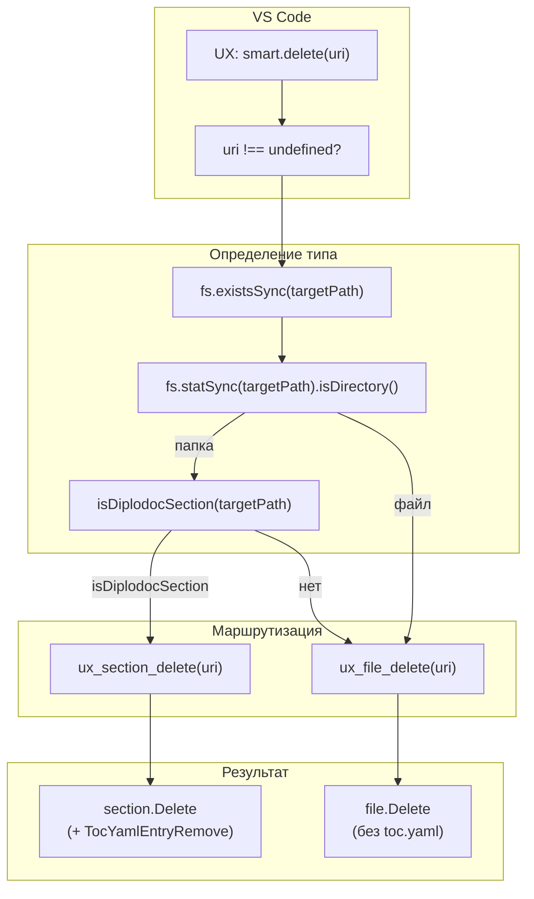
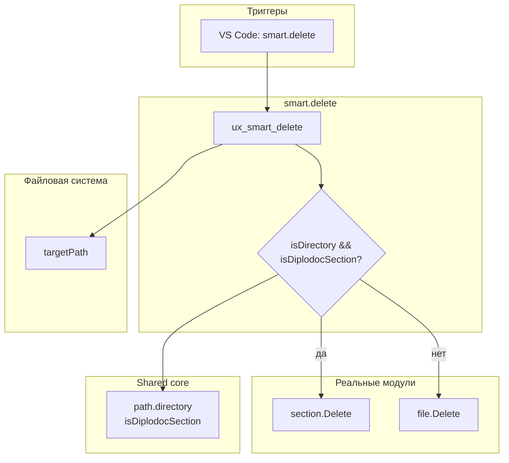

|               |                                                                                                               |
| ------------- | ------------------------------------------------------------------------------------------------------------- |
| ID            | [1.2-040](../../%D0%A1%D0%BE%D0%B3%D0%BB%D0%B0%D1%88%D0%B5%D0%BD%D0%B8%D1%8F/index.md#identifikaciya-modulej) |
| Идентификатор | `smart.delete`                                                                                                |
| Наименование  | Умное удаление                                                                                                |
| Слой          | [vscode-ui](../%D0%A1%D0%BB%D0%BE%D0%B8layer/VsCodeUi/index.md#naznachenie)                                     |
| Расположение  | `src/commands/diplodoc-helper.smart.delete.js`                                                                |
| Точка входа   | `ux_smart_delete(uri)`                                                                                        |
| Версия        | `1.54.0`                                                                                                      |
| Назначение    | Универсальная команда «Удалить, очищая ссылки» — маршрутизирует на `section.Delete` или `file.Delete`         |

{: .page-legend }

## Назначение

`smart.delete` — «одна команда на всё». Пользователь кликает правой кнопкой на **любом** объекте в Explorer (папка-секция, файл `.md`, картинка `.png`/`.jpg`/`.svg`, произвольная папка) и выбирает **Diplodoc → Удалить, очищая ссылки** — модуль сам решает, что делать:

- **папка-секция** (`index.md` + `index.yaml` + `toc.yaml`) → [`section.Delete`](../МодульУдалениесекции/index.md) — удаляет с очисткой `toc.yaml` родителя и ссылок;
- **файл или не-секция** → [`file.Delete`](../МодульУдалениефайла/index.md) — удаляет с очисткой ссылок (без `toc.yaml`).

Зачем это нужно. У пользователя не должно быть когнитивной нагрузки «какой тип объекта я удаляю». В Explorer объекты визуально не отличаются: папка `Раздел1.Введение` (секция) и папка `_drafts` (не-секция) выглядят одинаково. `smart.delete` автоматически определяет тип и вызывает правильный модуль.

Плюс — в контекстном меню Explorer **одна** команда, а не две (`Удалить секцию` + `Удалить файл, очищая ссылки`). Меньше когнитивной нагрузки.

Модуль — «маршрутизатор» на 20 строк. Вся логика удаления — в `section.Delete` и `file.Delete`. `smart.delete` только выбирает.

## Применение

**Когда использовать:** всегда, когда пользователь хочет удалить что-то «с очисткой ссылок» — модуль сам решит, `section.Delete` или `file.Delete`.

**Когда НЕ использовать:** нужен «просто удалить без очистки» — стандартный `Delete` в Explorer.

**Альтернативы:**
- Две отдельные команды: `deleteSection` (только секции) и `file.Delete` (только файлы) — но они в контекстном меню не видны.

**Типичный сценарий:** ПКМ на любом объекте → **Diplodoc → Удалить, очищая ссылки** → маршрутизация → либо `section.Delete` (если секция), либо `file.Delete`.

## Как это работает



### Единственная фаза

```js
const { isDiplodocSection } = require('../plugins/utils/path.directory.js');
const { ux_section_delete } = require('./diplodoc-helper.section.Delete.js');
const { ux_file_delete } = require('./diplodoc-helper.file.Delete.js');

async function ux_smart_delete(uri) {
    if (!uri) return;

    const targetPath = uri.fsPath;

    if (fs.existsSync(targetPath) && fs.statSync(targetPath).isDirectory() && isDiplodocSection(targetPath)) {
        return ux_section_delete(uri);
    }

    return ux_file_delete(uri);
}

module.exports = { ux_smart_delete };
```

**20 строк.** По шагам:

1. **`if (!uri) return;`** — тихий выход, если вызвано без контекста. Как и в `section.*`/`file.*` — команда видна только в контекстном меню Explorer (`when: explorerResourceIsFolder || resourceExtname == .md || …`). Программный вызов без `uri` — ничего не делает.

2. **`fs.existsSync(targetPath)`** — проверка существования (race condition: файл мог быть удалён между кликом и вызовом).

3. **`fs.statSync(targetPath).isDirectory()`** — папка? Файлы всегда идут в `file.Delete`.

4. **`isDiplodocSection(targetPath)`** — папка содержит `index.md` + `index.yaml` + `toc.yaml`? Если да — `section.Delete`.

5. **`return ux_section_delete(uri)`** — маршрутизация. `return` — **await**-семантика (результат возвращается наружу, но `ux_smart_delete` — `async`, `section.Delete` — `async`, VS Code-команда получит `Promise`, VS Code его не ждёт — это норма для `registerCommand`).

6. **`return ux_file_delete(uri)`** — fallback.

### Различие поведения

| Объект                          | `isDiplodocSection` | Маршрут          | Что делает                                                            |
| ------------------------------- | ------------------- | ---------------- | --------------------------------------------------------------------- |
| Папка-секция                    | `true`              | `section.Delete` | Удаляет с `TocYamlEntryRemove` + `updateLinksAfterDelete`             |
| Папка-не-секция                 | `false`             | `file.Delete`    | Удаляет с `updateLinksAfterDelete` (без `toc.yaml`)                   |
| `.md`-файл                      | —                   | `file.Delete`    | Удаляет с `updateLinksAfterDelete`                                    |
| Картинка (`.png`/`.jpg`/`.svg`) | —                   | `file.Delete`    | Удаляет с `updateLinksAfterDelete`                                    |
| Несуществующий путь             | —                   | `file.Delete`    | `file.Delete` → `fs.statSync` → `throw` (см. «Известные ограничения») |

### Файлы модуля

| Файл                                             | Ответственность                   |
| ------------------------------------------------ | --------------------------------- |
| `src/commands/diplodoc-helper.smart.delete.js`   | `ux_smart_delete` — маршрутизатор |
| `src/plugins/utils/path.directory.js`            | `isDiplodocSection`               |
| `src/commands/diplodoc-helper.section.Delete.js` | `ux_section_delete`               |
| `src/commands/diplodoc-helper.file.Delete.js`    | `ux_file_delete`                  |

## Режимы работы

### VS Code

| Команда                        | Заголовок              | Где появляется                               |
| ------------------------------ | ---------------------- | -------------------------------------------- |
| `diplodoc-helper.smart.delete` | Удалить, очищая ссылки | Explorer → Diplodoc → Удалить, очищая ссылки |

`when` (`package.json`):

```json
{
    "command": "diplodoc-helper.smart.delete",
    "when": "explorerResourceIsFolder || resourceExtname == .md || resourceExtname == .png || resourceExtname == .jpg || resourceExtname == .svg",
    "group": "1.diplodoc.section@2"
}
```

- **`explorerResourceIsFolder`** — папки (любые);
- **`resourceExtname == .md`** — markdown;
- **`resourceExtname == .png || .jpg || .svg`** — картинки (только эти три).

`.jpeg`, `.gif`, `.webp` — команда **не видна**. См. «Известные ограничения».

### CLI

CLI-команды нет. Модуль — только VS Code.

### Сборочный пайплайн

В `docs-build.js` не участвует.

## Юнит-тесты





## Связи

`smart.delete` — «фасад» над двумя модулями. Единственная публичная команда «Удалить, очищая ссылки» в контекстном меню Explorer. `file.delete` (отдельная команда) в `menus` не показывается; `deleteSection` показывается как `Удалить секцию`, но только на папках-секциях.

| Команда в `menus`                  | Показывается на                      | Что делает        |
| ---------------------------------- | ------------------------------------ | ----------------- |
| `diplodoc-helper.createSection`    | Папки                                | `section.Create`  |
| **`diplodoc-helper.smart.delete`** | Папки, `.md`, `.png`, `.jpg`, `.svg` | **Маршрутизация** |
| `diplodoc-helper.renameSection`    | Папки                                | `section.Rename`  |
| `diplodoc-helper.moveSection`      | Папки                                | `section.Move`    |
| `diplodoc-helper.copyLink`         | Папки, `.md`, `.png`, `.jpg`, `.svg` | `link.Copy`       |

**`deleteSection`** (заголовок «Удалить секцию») — в `menus` **отсутствует** (только в `contributes.commands`, без записи в `menus`). То есть пользователь видит **только** `smart.delete` («Удалить, очищая ссылки»). Внутри — `section.Delete` или `file.Delete`.






