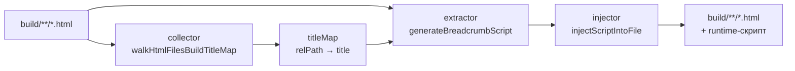
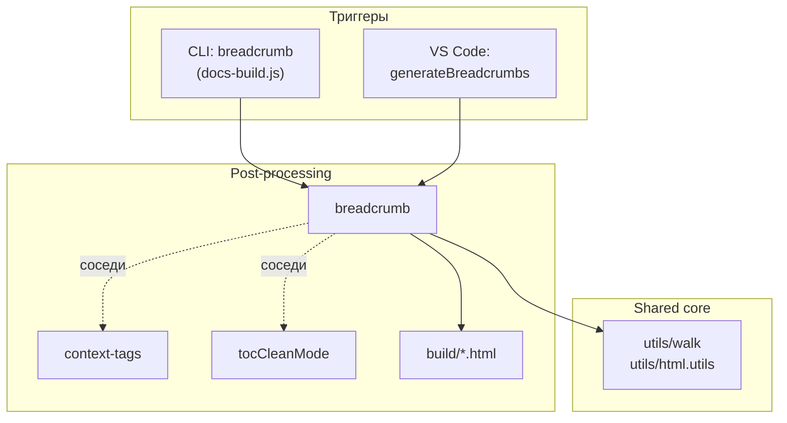



## Назначение

Модуль проходит по собранному HTML-дереву (`build/`) и внедряет на каждую страницу клиентский скрипт, который уже в браузере строит навигационную цепочку («хлебные крошки») в контейнере страницы.

Практический смысл: пользователь всегда видит, где он находится внутри документации, и может вернуться к любому из родительских разделов одним кликом — независимо от того, как глубоко он провалился.

## Применение

**Когда использовать:** нужна навигационная цепочка на каждой странице собранной документации — «где я, как вернуться к родителю».

**Когда НЕ использовать:** если тема Diplodoc уже рисует хлебные крошки через свой шаблон (тогда модуль продублирует навигацию).

**Альтернативы:**
- Стандартный `` / `` — не заменяют навигацию, только оформление.
- Ручной `<nav>` в шаблоне `.yfm` — работает, но не обновляется при переименовании/перемещении секций.

**Типичный сценарий:** `docs-build.js` → `post` → `footnoteAnchors` … → `breadcrumb` → готовый `build/` с крошками на каждой странице.

## Как это работает




1. **Сбор заголовков.** `walkHtmlFilesBuildTitleMap` обходит `build/`, пропускает `404.html`, `search.html` и корневой `index.html`. Заголовок каждой страницы берётся сначала из `<script id="diplodoc-state">` (`state.data.title` или `state.title`), затем из `<title>`. Получается карта `относительныйПуть → заголовок`.
2. **Генерация скрипта.** Для каждой страницы шаблон `breadcrumb.template.js` параметризуется:
   - всей картой `titleMap` — по ней клиент ищет заголовки родителей;
   - `lang` и `parentSegments`, выделенными из пути;
   - классами и селектором контейнера из `breadcrumb.config.js`.
3. **Инъекция.** `injectScriptIntoFile` вставляет `<script>…</script>` перед `</body>`. Сам скрипт исполняется в браузере, создаёт `<nav class="dc-breadcrumb">` и вставляет его внутрь `.dc-doc-page__main`. Если контейнер ещё не появился в DOM, скрипт повторяет попытку через `setTimeout(…, 300)`.

Пропускаются:

- файлы из `ignoreFiles` (`404.html`, `search.html`);
- корневой `index.html`;
- страницы на 0–1 уровень от языка (`ru/index.html`, `ru/foo/index.html`) — у них нет родительской цепочки.

### Файлы модуля

| Файл                      | Ответственность                                                                                                                                                                                                                                                                                                                                   |
| ------------------------- | ------------------------------------------------------------------------------------------------------------------------------------------------------------------------------------------------------------------------------------------------------------------------------------------------------------------------------------------------- |
| `breadcrumb.js`           | `runGeneration(buildDir)` — оркестратор                                                                                                                                                                                                                                                                                                           |
| `breadcrumb.collector.js` | `walkHtmlFiles`, `walkHtmlFilesBuildTitleMap`                                                                                                                                                                                                                                                                                                     |
| `breadcrumb.extractor.js` | `extractTitleFromHtml`, `generateBreadcrumbScript`                                                                                                                                                                                                                                                                                                |
| `breadcrumb.injector.js`  | `injectScriptIntoFile`                                                                                                                                                                                                                                                                                                                            |
| `breadcrumb.template.js`  | клиентский скрипт-шаблон с плейсхолдерами <code>&#123;&#123;TITLES_MAP&#125;&#125;</code>, <code>&#123;&#123;SEPARATOR&#125;&#125;</code>, <code>&#123;&#123;CLASSES&#125;&#125;</code>, <code>&#123;&#123;CONTAINER_SELECTOR&#125;&#125;</code>, <code>&#123;&#123;LANG&#125;&#125;</code>, <code>&#123;&#123;PARENT_SEGMENTS&#125;&#125;</code> |
| `breadcrumb.config.js`    | `DEFAULT_CONFIG`                                                                                                                                                                                                                                                                                                                                  |
| `breadcrumb.href.js`      | `isFileProtocol`, `buildBreadcrumbHref` — экспортируется из `utils/index.js`, но шаблон их не использует (дублирует логику inline)                                                                                                                                                                                                                |

### Конфигурация `DEFAULT_CONFIG`

| Ключ                   | Значение                      | Комментарий                                                  |
| ---------------------- | ----------------------------- | ------------------------------------------------------------ |
| `separator`            | `' '`                         | Символ между элементами цепочки                              |
| `cssClasses.nav`       | `dc-breadcrumb`               |                                                              |
| `cssClasses.list`      | `dc-breadcrumb__list`         |                                                              |
| `cssClasses.item`      | `dc-breadcrumb__item`         |                                                              |
| `cssClasses.link`      | `dc-breadcrumb__link`         |                                                              |
| `cssClasses.separator` | `dc-breadcrumb__separator`    |                                                              |
| `containerSelector`    | `.dc-doc-page__main`          | Куда вставляется `<nav>`                                     |
| `ignoreFiles`          | `['404.html', 'search.html']` |                                                              |
| `templateFile`         | `'./breadcrumb.template.js'`  | **не читается**: путь к шаблону захардкожен в `extractor.js` |

## Режимы работы

### VS Code

| Команда                               | Заголовок                | Где появляется                    |
| ------------------------------------- | ------------------------ | --------------------------------- |
| `diplodoc-helper.generateBreadcrumbs` | Сформировать breadcrumbs | Explorer → Diplodoc → Breadcrumbs |

Путь к сборке вычисляется как `path.join(projectRoot, '..', 'build')` — то есть **на уровень выше** корня воркспейса. Если папки нет, выводится модальное сообщение с просьбой пересобрать проект (см. `plugin.breadcrumb.generate.error.foldernotfound` / `plugin.breadcrumb.generate.error.detail` в NLS).

### CLI

```bash
node ./plugins/diplodoc-helper-cli.js breadcrumb --outputDir ./build
```

| Аргумент      | Обязателен | По умолчанию | Описание       |
| ------------- | ---------- | ------------ | -------------- |
| `--outputDir` | нет        | `./build`    | Каталог сборки |

Код возврата: `0` при успехе; `1`, если папка не найдена (для оркестратора).

### Сборочный пайплайн

В `docs-build.js` (фаза `post`) — отдельный шаг `breadcrumb`:

```js
cli('breadcrumb', './build'),
```

Идёт после копирования `mdedit_fixes`, до `contexttags`. Может быть отфильтрован флагом `--skip=breadcrumb` при вызове `docs-build.js`.

## Юнит-тесты





Сейчас покрытие — только smoke-проверки экспорта; содержательных тестов нет.

## Связи

Модуль `breadcrumb` — один из шагов пост-обработки HTML. Работает с готовым `build/` независимо от других пост-процессоров. Единственный «сосед по данным» — `context-tags` (тоже читает и модифицирует `build/*.html`); они не пересекаются по содержимому и разведены по порядку в пайплайне (`breadcrumb` → `contexttags`). Вспомогательные зависимости — `utils/walk`, `utils/html.utils`.








