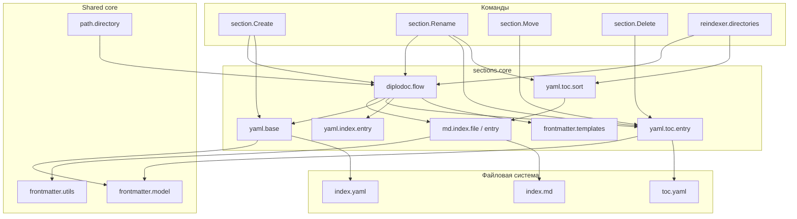

|               |                                                                                                                                                                                                                                                                                                                         |
| ------------- | ----------------------------------------------------------------------------------------------------------------------------------------------------------------------------------------------------------------------------------------------------------------------------------------------------------------------- |
| ID            | [1.1-022](../../../%D0%A1%D0%BE%D0%B3%D0%BB%D0%B0%D1%88%D0%B5%D0%BD%D0%B8%D1%8F/index.md#identifikaciya-modulej)                                                                                                                                                                                                           |
| Идентификатор | `sections.core`                                                                                                                                                                                                                                                                                                         |
| Наименование  | Ядро секций                                                                                                                                                                                                                                                                                                             |
| Слой          | [Pre-processing](../../%D0%A1%D0%BB%D0%BE%D0%B8layer/%D0%A1%D0%BB%D0%BE%D0%B9Preprocessing/index.md#naznachenie)                                                                                                                                                                                                                                  |
| Каталог       | [Структура](../../%D0%9A%D0%B0%D1%82%D0%B0%D0%BB%D0%BE%D0%B3Capabilitymap/%D0%9A%D0%B0%D1%82%D0%B0%D0%BB%D0%BE%D0%B3%D0%A1%D1%82%D1%80%D1%83%D0%BA%D1%82%D1%83%D1%80%D0%B0/index.md#struktura)                                                                                                                                                                                                                                                                                                                        |
| Семейство     | [Структура](../../%D0%A1%D0%B5%D0%BC%D0%B5%D0%B9%D1%81%D1%82%D0%B2%D0%BEfamily/%D0%A1%D0%B5%D0%BC%D0%B5%D0%B9%D1%81%D1%82%D0%B2%D0%BE%D0%A1%D1%82%D1%80%D1%83%D0%BA%D1%82%D1%83%D1%80%D0%B0/index.md#fam-structure)                                                                                                     |
| Расположение  | `src/plugins/utils/diplodoc.flow.js`, `src/plugins/utils/md.index.file.js`, `src/plugins/utils/md.index.entry.js`, `src/plugins/utils/yaml.base.js`, `src/plugins/utils/yaml.toc.entry.js`, `src/plugins/utils/yaml.index.entry.js`, `src/plugins/utils/yaml.toc.sort.js`, `src/plugins/model/frontmatter.templates.js` |
| Точка входа   | набор чистых функций (см. «Файлы модуля»)                                                                                                                                                                                                                                                                               |
| Версия        | `1.54.0`                                                                                                                                                                                                                                                                                                                |
| Назначение    | Общие утилиты для создания, переименования и переиндексации секций — работа с `index.md`, `index.yaml`, `toc.yaml`                                                                                                                                                                                                      |

{: .page-legend }

## Назначение

`sections.core` — не команда и не пользовательский модуль, а **инфраструктурный слой**, на котором держатся четыре операции над секциями:

- **создание** ([`section.Create`](../МодульСозданиесекции/index.md)) — создаёт папку и три файла (`index.md`, `index.yaml`, `toc.yaml`), добавляет запись в родительский `toc.yaml`;
- **переименование** ([`section.Rename`](../МодульПереименованиесекции/index.md)) — меняет `title`/`pureTitle`/`sectionType`/`sectionIndex`, переименовывает папку, обновляет ссылки;
- **перемещение** ([`section.Move`](../МодульПеремещениесекции/index.md)) — переносит папку в другого родителя, обновляет оба `toc.yaml`;
- **переиндексация** ([`reindexer.directories`](../МодульПереиндексация/index.md)) — пересчитывает индексы и переименовывает папки массово.

Каждая команда — это «тонкая обёртка»: диалог с пользователем + последовательность вызовов `sections.core`-функций. Логика (как записать `index.md`, как синхронизировать `toc.yaml`, как сформировать имя папки) — здесь.

Модуль не имеет собственной точки запуска. Ни CLI, ни VS Code-команды. Только `require` из команд.

## Состав

### `md.index.file.js` — работа с `index.md`

| Функция                                                                                | Назначение                                                                              |
| -------------------------------------------------------------------------------------- | --------------------------------------------------------------------------------------- |
| `IndexMdFileRead(folderPath)`                                                          | Читает `index.md` → `data` (frontmatter через `gray-matter`)                            |
| `IndexMdFilePatch(folderPath, pureTitle, sectionTypeName, sectionLabel, sectionIndex)` | Обновляет `title`, `pureTitle`, `sectionType`, `sectionIndex` в существующем `index.md` |
| `IndexMdUpsert(folderPath, pureTitle, sectionTypeName, sectionLabel, sectionIndex)`    | Создаёт `index.md`, если нет; обновляет, если есть                                      |

`patchFrontmatterSection` — внутренняя: собирает `composedTitle` через `TEMPLATE_FINAL_TITLE` и записывает в frontmatter.

### `md.index.entry.js` — чтение полей `index.md`

| Функция                                   | Назначение                               |
| ----------------------------------------- | ---------------------------------------- |
| `IndexMdEntryReadIndex(folderPath)`       | Читает `sectionIndex`                    |
| `IndexMdEntryReadTitle(folderPath)`       | Читает `pureTitle` (fallback на `title`) |
| `IndexMdEntryReadSectionType(folderPath)` | Читает `sectionType`                     |

Тонкие обёртки над `IndexMdFileRead`. Используются в `reindexer.directories` и `yaml.toc.sort`.

### `yaml.base.js` — создание файлов секции

| Функция                                                                                       | Назначение                                                             |
| --------------------------------------------------------------------------------------------- | ---------------------------------------------------------------------- |
| `IndexMdFileCreate(folderPath, title, sectionType, sectionValue, sectionIndex)`               | Создаёт `index.md` с frontmatter                                       |
| `IndexYamlFileCreate(folderPath, title, sectionType, sectionLabel, sectionIndex)`             | Создаёт `index.yaml` (YAML-словарь о разделе)                          |
| `TocYamlFileCreate(folderPath, title, sectionLabel, sectionIndex)`                            | Создаёт `toc.yaml` внутри секции                                       |
| `TocYamlEntryPatchItems(parentDir, sectionTitle, sectionTypeLabel, folderName, sectionIndex)` | Добавляет запись в родительский `toc.yaml` (`items.push`)              |
| `IndexYamlEntryPatch(folderPath, newPureTitle, newSectionType, userIndex)`                    | Обновляет `title`, `description`, `meta.*`, `pureTitle` в `index.yaml` |

### `yaml.toc.entry.js` — работа с `toc.yaml`

| Функция                                                                                 | Назначение                                               |
| --------------------------------------------------------------------------------------- | -------------------------------------------------------- |
| `TocYamlEntryRemove(parentDir, folderName)`                                             | Удаляет запись по `href` из `toc.yaml`                   |
| `TocYamlEntryCreate(parentDir, composedTitle, folderName, sectionType, sectionIndex)`   | Добавляет запись в конец `items`                         |
| `TocYamlEntryUpdateOrAppend(parentDir, oldFolderName, composedTitle, newFolderName, …)` | Обновляет запись по старому `href` или добавляет в конец |
| `TocYamlEntryInsertAtPosition(targetDir, composedTitle, folderName, positionObj)`       | Вставляет запись в начало / конец / после указанной      |
| `TocYamlEntryMoveWithinSameFile(targetDir, composedTitle, folderName, positionObj)`     | Меняет позицию записи в том же `toc.yaml`                |
| `TocYamlEntryPatch(tocDoc, folderName, newName)`                                        | Правит `name` записи в уже загруженном объекте           |
| `TocYamlEntryPatchTitle(folderPath, composedTitle)`                                     | Меняет `title` в `toc.yaml` самой секции                 |
| `TocYamlEntryPatchReference(parentDir, oldFolderName, newFolderName)`                   | Меняет `href` и `include.path` при переименовании папки  |

Все функции сохраняют `toc.yaml` в **формате `YAML.stringify`** (пакет `yaml`), а не `js-yaml` — важно: порядок ключей и отступы зависят от него.

### `yaml.index.entry.js` — точечные правки `index.yaml`

| Функция                                                                                          | Назначение                                                                        |
| ------------------------------------------------------------------------------------------------ | --------------------------------------------------------------------------------- |
| `IndexYamlEntryPatchHRef(parentDir, oldFolderName, newFolderName, composedTitle)`                | Меняет `href` и `name` в `index.yaml` **родителя**                                |
| `IndexYamlEntryPatchSection(folderPath, pureTitle, sectionTypeName, sectionLabel, sectionIndex)` | Меняет `title`/`pureTitle`/`sectionType`/`sectionIndex` в `index.yaml` **секции** |

В отличие от `yaml.base.IndexYamlEntryPatch` (использует `js-yaml.dump`), эти функции делают **regex-замены по тексту**. Формат `index.yaml` может отличаться от того, что выдал бы `js-yaml.dump`. Обратная сторона — `IndexYamlEntryPatchSection` не сломает ручные комментарии в `index.yaml`, если они там были.

### `yaml.toc.sort.js` — сортировка `toc.yaml`

| Функция                                      | Назначение                                                      |
| -------------------------------------------- | --------------------------------------------------------------- |
| `sortTocItems(baseDir, sortOrder, sortKind)` | Сортирует `items` по `sectionIndex` из `index.md` каждой записи |
| `compareIndexes(a, b, order)`                | Сравнение индексов как массивов чисел (`1.2.3` < `1.3`)         |

`sortOrder = 'ascending' | 'descending'`, `sortKind = 'nonIndexedTop' | 'nonIndexedBottom'`.

### `diplodoc.flow.js` — «сценарии»

| Функция                                                                                      | Назначение                                                                            |
| -------------------------------------------------------------------------------------------- | ------------------------------------------------------------------------------------- |
| `createSectionFolder(targetDir, sectionType, sectionName, sectionIndex, onError)`            | Создаёт папку; возвращает `{ folderPath, folderName }` или `null`                     |
| `DiplodocSectionRefresh(folderPath, pureTitle, sectionTypeName, sectionLabel, sectionIndex)` | Обновляет все три файла (index.md, index.yaml, toc.yaml), **не переименовывая** папку |
| `DiplodocSectionPatch(folderPath, pureTitle, sectionType, sectionIndex)`                     | Переименовывает папку + обновляет все три файла + правит родительский `toc.yaml`      |

`DiplodocSectionPatch` — самая «сложная»: вызывает `fs.renameSync`, `TocYamlEntryPatchReference` (родитель), `TocYamlEntryPatchTitle` (свой), `IndexYamlEntryPatch`, `IndexMdUpsert`. Если `newFolderName === oldFolderName` — просто возвращает старое имя без действий.

### `frontmatter.templates.js` — шаблоны

| Функция                                                                                        | Назначение                                                               |
| ---------------------------------------------------------------------------------------------- | ------------------------------------------------------------------------ |
| `TEMPLATE_FINAL_TITLE(sectionValue, sectionIndex, title)`                                      | `"Раздел 1. Введение"` (или `"Введение"`, если `sectionValue` пуст)      |
| `TEMPLATE_FOLDER_NAME(sectionType, sectionName, sectionIndex)`                                 | `"Раздел1.Введение"` (без пробелов)                                      |
| `TEMPLATE_INDEX_MD` / `TEMPLATE_INDEX_YAML` / `TEMPLATE_TOC_YAML` / `TEMPLATE_PARENT_TOC_YAML` | Строковые шаблоны (создаются в `yaml.base.js`, не используются напрямую) |

**Правило формирования имени папки** (из `TEMPLATE_FOLDER_NAME`):

| `sectionType.value` | `sectionIndex` | Имя папки          |
| ------------------- | -------------- | ------------------ |
| `'Раздел'`          | `'1'`          | `Раздел1.Введение` |
| `'Раздел'`          | `''`           | `Раздел.Введение`  |
| `''` (статья)       | `'1.5'`        | `1.5.Введение`     |
| `''`                | `''`           | `Введение`         |

Пробелы и запрещённые символы в названии удаляются (`/[^27]/g`). `sectionType.label` в имени не участвует — только `value`.

### Вспомогательные (`path.directory.js`)

| Функция                                                                  | Назначение                                                           |
| ------------------------------------------------------------------------ | -------------------------------------------------------------------- |
| `isDiplodocSection(folderPath)`                                          | Проверяет наличие трёх файлов (`index.md`, `index.yaml`, `toc.yaml`) |
| `isLanguageRoot(folderPath)`                                             | `toc.yaml` есть, `index.md` нет — корень языка                       |
| `canCreateFolder(folderPath, onError)`                                   | Проверяет права и отсутствие файла                                   |
| `createDirectory(canCreateFolder, path, recursive, folderName, onError)` | Создаёт папку                                                        |

## Применение

**Когда использовать:** вы пишете новый модуль, который правит секции (`index.md`, `index.yaml`, `toc.yaml`) — берите готовые функции, а не дублируйте.

**Когда НЕ использовать:** вы просто работаете с документацией через готовые команды `section.*` — эти утилиты вызываются автоматически.

**Альтернативы:**
- `fs.writeFileSync` вручную — сломает формат YAML/frontmatter, потеряет комментарии.
- Прямое редактирование `toc.yaml` — не синхронизирует `include.path`.

**Типичный сценарий:** пишете новый модуль `section.Clone` — вызываете `IndexMdUpsert`, `DiplodocSectionPatch`, `TocYamlEntryInsertAtPosition` из этого ядра.

## Как это работает

### Сценарий «Создать секцию»

`section.Create` вызывает по порядку:

1. `calculateNextIndex(targetDir)` (из `reindexer.md`) — `1`, `2.3` и т.д.
2. `createSectionFolder` (`diplodoc.flow`) — `fs.mkdirSync`.
3. `IndexMdFileCreate` (`yaml.base`) — пишет frontmatter.
4. `IndexYamlFileCreate` (`yaml.base`) — пишет словарь.
5. `TocYamlFileCreate` (`yaml.base`) — пишет мини-toc.
6. `TocYamlEntryPatchItems` (`yaml.base`) — добавляет запись в родительский `toc.yaml`.

### Сценарий «Переименовать»

`section.Rename` вызывает:

1. `IndexMdEntryReadIndex` / `IndexMdEntryReadTitle` / `IndexMdEntryReadSectionType` — читает текущее.
2. Диалог с пользователем (новое имя, тип, индекс).
3. `composeFullTitle` / `composeFolderName` (`frontmatter.section.title`) — строит целевые значения.
4. `TocYamlEntryUpdateOrAppend` (`yaml.toc.entry`) — обновляет родительский `toc.yaml`.
5. `DiplodocSectionPatch` (`diplodoc.flow`) — переименовывает папку + переписывает все три файла секции.
6. `updateLinksAfterRename` (`diplodoc-helper.links.md`) — правит ссылки во всём проекте.
7. `sortTocItems` — если изменились индекс/тип.

### Сценарий «Переместить»

`section.Move` вызывает:

1. `selectTargetDirectory` / `selectInsertPosition` (QuickPick).
2. `TocYamlEntryRemove` (старый родитель).
3. `fs.renameSync` — папка в новый родитель.
4. `updateLinksAfterRename` — ссылки.
5. `TocYamlEntryInsertAtPosition` (новый родитель) — вставка.
   — Или, если тот же родитель: `TocYamlEntryMoveWithinSameFile`.

### Сценарий «Удалить»

`section.Delete` вызывает:

1. `findReferencesToMdSection` — собирает ссылки на раздел.
2. `TocYamlEntryRemove` — удаляет запись из родительского `toc.yaml`.
3. `updateLinksAfterDelete` — заменяет ссылки на `**удалено**`.
4. `fs.rmSync` — удаляет папку.

### Сценарий «Переиндексировать»

`reindexer.directories` (не в этом модуле, но использует `sections.core`):

1. `getSectionMetadata` — читает текущее.
2. `DiplodocSectionPatch` — переименовывает папку + переписывает файлы.
3. `TocYamlEntryPatch` — правит `name` в `toc.yaml`.
4. `sortTocItems` — сортирует.
5. Рекурсия по дочерним папкам.

## Режимы работы

Модуль не имеет собственной точки запуска. Все сценарии — через `section.*` команды и `reindexer.directories`.

## Юнит-тесты





## Связи

`sections.core` — «библиотека» для пяти модулей:

| Модуль                  | Использует из `sections.core`                                                                                                                                |
| ----------------------- | ------------------------------------------------------------------------------------------------------------------------------------------------------------ |
| `section.Create`        | `createSectionFolder`, `IndexMdFileCreate`, `IndexYamlFileCreate`, `TocYamlFileCreate`, `TocYamlEntryPatchItems`, `composeFullTitle`, `TEMPLATE_FOLDER_NAME` |
| `section.Rename`        | `IndexMdEntryRead*`, `DiplodocSectionPatch`, `DiplodocSectionRefresh`, `composeFullTitle`, `composeFolderName`, `TocYamlEntryUpdateOrAppend`, `sortTocItems` |
| `section.Move`          | `TocYamlEntryRemove`, `TocYamlEntryInsertAtPosition`, `TocYamlEntryMoveWithinSameFile`                                                                       |
| `section.Delete`        | `TocYamlEntryRemove`                                                                                                                                         |
| `reindexer.directories` | `getSectionMetadata`, `DiplodocSectionPatch`, `TocYamlEntryPatch`, `sortTocItems`, `IndexMdUpsert`, `IndexMdEntryReadIndex`                                  |

С `reindexer.md` — обратная зависимость: `section.Create` вызывает `calculateNextIndex` из `reindexer.md`, но `reindexer.md` — самостоятельный модуль (`frontmatter.utils` + `fs`).

С `diplodoc-helper.links.md` — `updateLinksAfterRename` и `updateLinksAfterDelete` живут в `links.md` (модуль `links`), но вызываются из `section.*`. См. будущую статью `links`.




