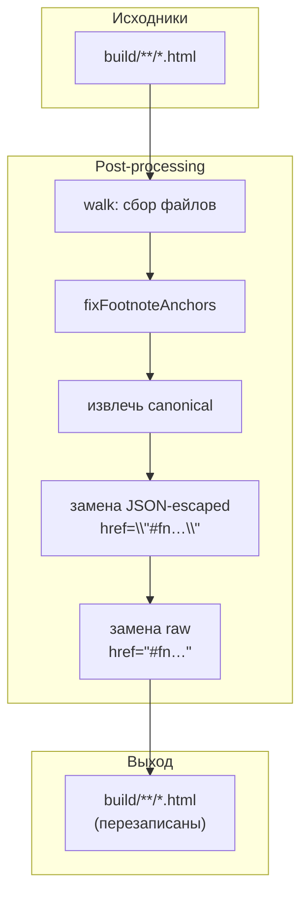
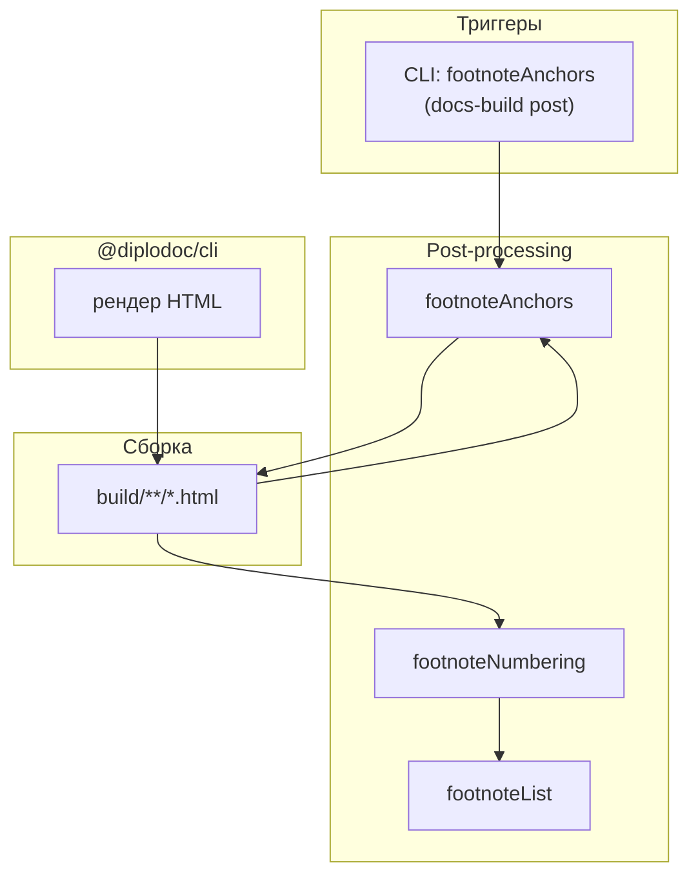

|               |                                                                                                               |
| ------------- | ------------------------------------------------------------------------------------------------------------- |
| ID            | [4.2-012](../../%D0%A1%D0%BE%D0%B3%D0%BB%D0%B0%D1%88%D0%B5%D0%BD%D0%B8%D1%8F/index.md#identifikaciya-modulej) |
| Идентификатор | `footnoteAnchors`                                                                                             |
| Наименование  | Якоря сносок                                                                                                  |
| Слой          | [post-processing](../%D0%A1%D0%BB%D0%BE%D0%B8layer/PostProcessing/index.md#naznachenie)                         |
| Расположение  | `src/plugins/footnoteAnchors/`                                                                                |
| Точка входа   | `fixFootnoteAnchors(buildDir)`                                                                                |
| Версия        | `1.54.0`                                                                                                      |
| Назначение    | Превращает относительные якоря `#fn…` / `#fnref…` в абсолютные URL страницы                                   |

{: .page-legend }

## Назначение

`@diplodoc/cli` рендерит сноски в HTML с **относительными** якорями: `<a href="#fn1">` для ссылки на определение и `<a href="#fnref1">` для обратной ссылки. Пока страница открыта в браузере по «родному» URL — работает. Но если HTML-фрагмент страницы извлекается из контекста (например, в `mdedit`-редакторе, в предпросмотре или при встраивании через `iframe`/`file://`), относительный `#fn1` «указывает в никуда» — браузер ищет `id="fn1"` в текущем документе, а его там нет.

Модуль решает эту проблему: проходит по `build/**/*.html`, для каждой страницы читает `<link rel="canonical" href="…">` (абсолютный URL, который Diplodoc ставит в `<head>`) и заменяет все `href="#fn…"` и `href="#fnref…"` на `href="<canonical>#fn…"` (соответственно `#fnref…`). После этого ссылка на сноску — всегда абсолютный URL конкретной страницы, независимо от контекста открытия.

Модуль работает только в `post-processing`, один файл, нет клиентского скрипта, нет VS Code-команды.

## Применение

**Когда использовать:** сноски в `.md` уже нумерованы, но их якоря в `.html` относительные (`#fn1`) — при встраивании в iframe/`file://`/предпросмотре они не работают.

**Когда НЕ использовать:** документация всегда открывается по «родному» URL — относительные якоря работают.

**Альтернативы:**
- `mdedit_fixes/fix-footnote-links.js` — клиентский фикс через `window.location.pathname`, но работает только если скрипт подключён и только в браузере.
- `footnoteNumbering` — тоже правит `.html`, но не якоря, а номера.

**Типичный сценарий:** `docs-build.js` → `post` → `footnoteAnchors` (первый шаг post) → в `build/` якоря сносок абсолютные.

## Как это работает



### Алгоритм

1. **`fixFootnoteAnchors(buildDir)`** — рекурсивный обход `buildDir` собирает все `*.html` в массив `files`.

2. **Для каждого файла:**
   - читается содержимое;
   - ищется `<link rel="canonical" href="…">`. Если его нет (например, `404.html`) — файл пропускается;
   - `canonical` извлекается как строка, без дальнейшего парсинга URL;
   - два `replace`-прохода по регуляркам:
     - **JSON-escaped** — `href=\"#fn1\"`, `href=\"#fnref1\"` (внутри `<script id="diplodoc-state">` Diplodoc хранит HTML-фрагмент как JSON-строку с экранированными кавычками);
     - **raw** — `href="#fn1"`, `href="#fnref1"` (для случая, если шаблон в будущем изменится и HTML попадёт в разметку без JSON-обёртки).
   - если содержимое изменилось — записывается обратно.

3. **Результат:** массив `{ success, failed }` с путями. В CLI это не используется (только в VS Code-обёртке для сообщения пользователю).

### Ключевые регулярки

```js
// JSON-escaped (внутри diplodoc-state)
/href=\\"#(fn(?:ref)?\d+)\\"/gi

// raw (в разметке)
/href="#(fn(?:ref)?\d+)"/gi
```

`fn(?:ref)?\d+` — покрывает `fn1`, `fn12`, `fnref1`, `fnref12`. Не покрывает `fn-abc` или другие нечисловые id — только числовые (что соответствует рендеру `@diplodoc/cli`).

### Файлы модуля

| Файл                      | Ответственность                                           |
| ------------------------- | --------------------------------------------------------- |
| `fix-footnote-anchors.js` | `fixFootnoteAnchors(buildDir)` — точка входа, весь модуль |

### Пример до и после

**До** (внутри `<script id="diplodoc-state">`):

```json
{
  "html": "... <a class=\"footnote-ref\" href=\"#fn1\">[1]</a> ..."
}
```

**После:**

```json
{
  "html": "... <a class=\"footnote-ref\" href=\"https://docs.example.com/ru/foo/index.html#fn1\">[1]</a> ..."
}
```

`canonical` берётся из `<link rel="canonical" href="https://docs.example.com/ru/foo/index.html">`, который `@diplodoc/cli` ставит в `<head>` каждой страницы (обычно — из `baseUrl` в `.yfm` или из конфига проекта).

## Режимы работы

### CLI

```bash
node ./plugins/diplodoc-helper-cli.js footnoteAnchors ./build
```

| Аргумент | Обязателен | По умолчанию | Описание                              |
| -------- | ---------- | ------------ | ------------------------------------- |
| `<path>` | нет        | `./build`    | Каталог сборки (позиционный аргумент) |

**Важно:** `footnoteAnchors` — единственная CLI-команда, где путь к сборке передан **позиционно** (не через `--outputDir`). Смотри `diplodoc-helper-cli.js`:

```js
} else if (command === 'footnoteAnchors') {
    fixFootnoteAnchors(outputDir);
}
```

Хотя переменная называется `outputDir` и раньше в диспетчере парсится из `--outputDir`, семантика использования — «build-каталог». Тот же `outputDir` идёт в `breadcrumb`, `contexttags`, `tocCleanMode`, `ganttFixScroll`. То есть команда работает по соглашению: `--outputDir` — это путь к `build/`.

Код возврата: `0`. Если хоть один файл упал — `results.failed.length > 0` в `require.main === module`:

```js
const r = fixFootnoteAnchors(buildDir);
if (r.failed.length > 0) process.exitCode = 1;
```

В остальных командах CLI модуль не возвращает `failed` наружу — здесь есть.

### Сборочный пайплайн

В `docs-build.js`, фаза `post`, **первый** шаг:

```js
cli('footnoteAnchors', './build'),
```

Идёт сразу после `@diplodoc/cli`, до `abbrTitles`, `termTitles`, `footnoteNumbering`, `footnoteList`, `gostsInject`, `breadcrumb`.

Порядок критичен: `footnoteAnchors` — самый ранний «фиксер» HTML. Он работает с исходной разметкой сносок, которую `@diplodoc/cli` только что отрендерил. Все последующие шаги (особенно `footnoteNumbering`, который меняет `id="fn1"` на `id="fn5"` при сквозной нумерации) работают уже с **исправленными** якорями.

Пропускается флагом `--skip=footnoteAnchors`.

## Юнит-тесты





## Связи

`footnoteAnchors` — один из трёх модулей пост-обработки сносок. С другими не пересекается:

- **[`footnotes`](../МодульСноски/index.md) (pre)** — пересчитывает нумерацию в `.md`;
- **`footnoteAnchors` (post, этот модуль)** — делает якоря абсолютными в `.html`;
- **[`footnoteNumbering`](../МодульСквознаянумерациясносок/index.md) (post, следующий)** — делает нумерацию сносок сквозной в `.html`;
- **[`footnoteList`](../МодульПереченьсносок/index.md) (post)** — собирает сводный перечень сносок по проекту.

Никаких зависимостей от `shared-core`: модуль сам обходит файлы (`fs.readdirSync`), сам ищет `canonical`, сам делает `replace`. Даже `utils/walk` не используется — обход написан вручную в 8 строк.

С `@diplodoc/cli` — неявная зависимость: модуль рассчитывает, что рендер `@diplodoc/cli` создаёт `href="#fn…"` и `<link rel="canonical">` именно в том виде, в каком модуль их ищет. Если `@diplodoc/cli` переименует префикс (`fn` → `footnote`, `#` → `#hash-`) — модуль молча перестанет работать (не найдёт совпадений, `totalFixed = 0`, но `success: true`).






