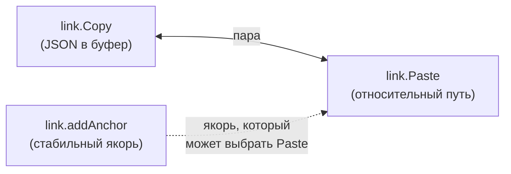
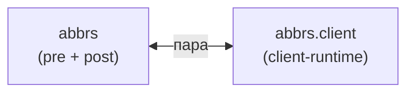
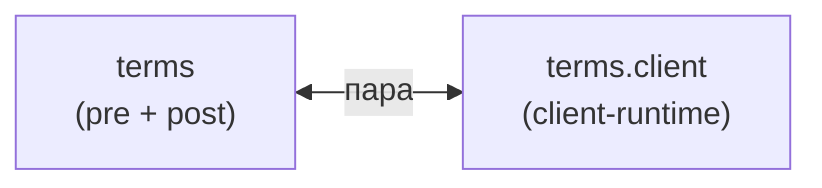
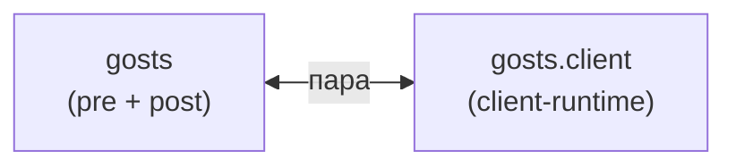
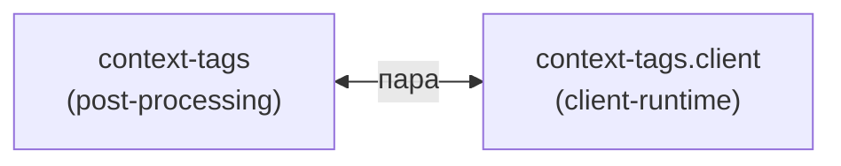
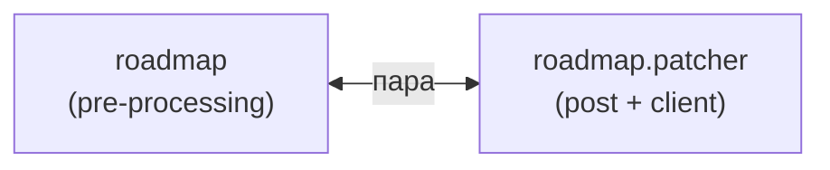
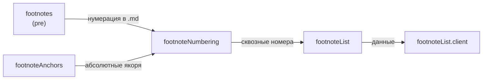

|               |                                                                          |
| ------------- | ------------------------------------------------------------------------ |
| Идентификатор | `modules.families`                                                       |
| Слой          | shared-core                                                              |
| Назначение    | Модули в парах и цепочках: что не работает в одиночку, что читать вместе |

{: .page-legend }

## Назначение

**Family** — это «с кем модуль работает в паре». Не «ради чего» (это `capability`, см. [Каталог](../КаталогCapabilitymap/index.md)), не «когда запускается» (это `layer`, см. [Слои](../Слоиlayer/index.md)). Именно **связь с другими модулями**.

Family особенно полезен, если вы:

- читаете статью `link.Copy` и не понимаете, зачем она — она бессмысленна без `link.Paste`;
- читаете `abbrs` (генератор) и хотите понять, где «клиентская часть» — это `abbrs.client`;
- разбираетесь, почему `footnotes` — это 5 модулей, а не 1;
- хотите пропустить ненужное: если не используете сноски, все 5 модулей нерелевантны.

## Два уровня семей

Семьи бывают **строгие** (модули не работают в одиночку) и **свободные** (модули полезны по отдельности, но читать их лучше вместе).

| Тип           | Что                                       | Пример                          |
| ------------- | ----------------------------------------- | ------------------------------- |
| **Строгая**   | Модуль бесполезен без пары                | `link.Copy` ↔ `link.Paste`      |
| **Свободная** | Модуль работает один, но связан с другими | `figures` + `reindexer.figures` |

Ниже — сначала строгие, потом свободные.

## Семьи (14)

Четырнадцать семей: 7 строгих (модули не работают по отдельности) и 7 свободных (полезны самостоятельно, но связаны тематически). Полное описание — в подразделах ниже.

|     | Семья                                                  | Тип       | Что связывает                                     | Модулей |
| --- | ------------------------------------------------------ | --------- | ------------------------------------------------- | ------- |
| 1   | [Ссылки (`link`)](#fam-link)                           | строгая   | `link.Copy` ↔ `link.Paste`                        | 3       |
| 2   | [Аббревиатуры (`abbr`)](#fam-abbr)                     | строгая   | `abbrs` (генератор) ↔ `abbrs.client`              | 2       |
| 3   | [Термины (`term`)](#fam-term)                          | строгая   | `terms` (генератор) ↔ `terms.client`              | 2       |
| 4   | [ГОСТы (`gost`)](#fam-gost)                            | строгая   | `gosts` (генератор) ↔ `gosts.client`              | 2       |
| 5   | [Контекстные теги (`context-tags`)](#fam-context-tags) | строгая   | `context-tags` (инжектор) ↔ `context-tags.client` | 2       |
| 6   | [Дорожная карта (`roadmap`)](#fam-roadmap)             | строгая   | `roadmap` (генератор) ↔ `roadmap.patcher`         | 2       |
| 7   | [Сноски (`footnote`)](#fam-footnote)                   | строгая   | цепочка из 5 модулей                              | 5       |
| 8   | [Структура](#fam-structure)                            | свободная | секции + `reindexer` + удаление                   | 9       |
| 9   | [Иллюстрации](#fam-illustrations)                      | свободная | вставка + каталог + нумерация                     | 4       |
| 10  | [Контексты](#fam-contexts)                             | свободная | `contexts` + поиск + карта                        | 4       |
| 11  | [Helptags](#fam-helptags)                              | свободная | `helptags` + `helpMap` + карта                    | 3       |
| 12  | [Отчёты](#fam-reports)                                 | свободная | 4 отчёта + `core-renderer`                        | 5       |
| 13  | [Линтеры](#fam-linters)                                | свободная | 3 линтера                                         | 3       |
| 14  | [Инфраструктура](#fam-infrastructure)                  | свободная | CLI + оркестратор + `manifest`                    | 5       |

**Колонка «Модулей»** — количество модулей в семье. Модули, входящие в **несколько** семей (`helpMap` — и в «Контекстах», и в «Helptags», и в «Отчётах»), считаются в **каждой** семье. Поэтому сумма по столбцу больше 50.

## Строгие семьи (7)

### 1. Ссылки (`link`) {#fam-link}

Пара «скопировать → вставить». `link.Copy` кладёт JSON в буфер, `link.Paste` читает и вставляет с корректным путём. **По отдельности бессмысленны** — JSON в буфере некому прочитать.

`link.addAnchor` — «свободный участник» семьи: создаёт якорь, который `link.Paste` потом предлагает в QuickPick. Но `addAnchor` полезен и сам по себе (если пользователь делает ссылку вручную).

| ID                                                         | Модуль           | Роль       |
| ---------------------------------------------------------- | ---------------- | ---------- |
| [2.2-027](../%D0%A0%D0%B5%D0%B5%D1%81%D1%82%D1%80/%D0%9C%D0%BE%D0%B4%D1%83%D0%BB%D1%8C%D0%9A%D0%BE%D0%BF%D0%B8%D1%80%D0%BE%D0%B2%D0%B0%D0%BD%D0%B8%D0%B5%D1%81%D1%81%D1%8B%D0%BB%D0%BA%D0%B8/index.md#naznachenie) | `link.Copy`      | **Пара 1** |
| [2.2-029](../%D0%A0%D0%B5%D0%B5%D1%81%D1%82%D1%80/%D0%9C%D0%BE%D0%B4%D1%83%D0%BB%D1%8C%D0%92%D1%81%D1%82%D0%B0%D0%B2%D0%BA%D0%B0%D1%81%D1%81%D1%8B%D0%BB%D0%BA%D0%B8/index.md#naznachenie)     | `link.Paste`     | **Пара 2** |
| [2.1-028](../%D0%A0%D0%B5%D0%B5%D1%81%D1%82%D1%80/%D0%9C%D0%BE%D0%B4%D1%83%D0%BB%D1%8C%D0%94%D0%BE%D0%B1%D0%B0%D0%B2%D0%BB%D0%B5%D0%BD%D0%B8%D0%B5%D1%8F%D0%BA%D0%BE%D1%80%D1%8F/index.md#naznachenie)   | `link.addAnchor` | Свободный  |

### 2. Аббревиатуры (`abbr`) {#fam-abbr}

Пара «генератор → клиент». `abbrs` (pre) собирает словарь и генерирует указатель, `abbrs.injector` (post) обогащает `<abbr>` тултипами, `abbrs.client` (client) оживляет разметку в браузере. **`abbrs` без `abbrs.client`** — работает (страница-указатель есть), но тултипы не показываются.

| ID                                                          | Модуль         | Роль       |
| ----------------------------------------------------------- | -------------- | ---------- |
| [3.2-003](../%D0%A0%D0%B5%D0%B5%D1%81%D1%82%D1%80/%D0%9C%D0%BE%D0%B4%D1%83%D0%BB%D1%8C%D0%90%D0%B1%D0%B1%D1%80%D0%B5%D0%B2%D0%B8%D0%B0%D1%82%D1%83%D1%80%D1%8B/index.md#naznachenie)       | `abbrs`        | **Пара 1** |
| [3.2-004](../%D0%A0%D0%B5%D0%B5%D1%81%D1%82%D1%80/%D0%9C%D0%BE%D0%B4%D1%83%D0%BB%D1%8C%D0%90%D0%B1%D0%B1%D1%80%D0%B5%D0%B2%D0%B8%D0%B0%D1%82%D1%83%D1%80%D1%8B%D0%9A%D0%BB%D0%B8%D0%B5%D0%BD%D1%82/index.md#naznachenie) | `abbrs.client` | **Пара 2** |

### 3. Термины (`term`) {#fam-term}

Точное зеркало `abbr`: та же структура, другой словарь (`terms.yaml` вместо `abbreviations.yaml`). `<abbr class="term">` — маркер, по которому модули отличают «свой» тег.

| ID                                                     | Модуль         | Роль       |
| ------------------------------------------------------ | -------------- | ---------- |
| [3.2-005](../%D0%A0%D0%B5%D0%B5%D1%81%D1%82%D1%80/%D0%9C%D0%BE%D0%B4%D1%83%D0%BB%D1%8C%D0%A2%D0%B5%D1%80%D0%BC%D0%B8%D0%BD%D1%8B/index.md#naznachenie)       | `terms`        | **Пара 1** |
| [3.2-006](../%D0%A0%D0%B5%D0%B5%D1%81%D1%82%D1%80/%D0%9C%D0%BE%D0%B4%D1%83%D0%BB%D1%8C%D0%A2%D0%B5%D1%80%D0%BC%D0%B8%D0%BD%D1%8B%D0%9A%D0%BB%D0%B8%D0%B5%D0%BD%D1%82/index.md#naznachenie) | `terms.client` | **Пара 2** |

### 4. ГОСТы (`gost`) {#fam-gost}

Третье зеркало — ГОСТы. Отличие: `gosts.client` рисует **таблицу с карточками**, а не тултипы. `abbrs`/`terms` — про inline-разметку, `gosts` — про отдельную страницу.

| ID                                                    | Модуль         | Роль       |
| ----------------------------------------------------- | -------------- | ---------- |
| [3.1-002](../%D0%A0%D0%B5%D0%B5%D1%81%D1%82%D1%80/%D0%9C%D0%BE%D0%B4%D1%83%D0%BB%D1%8C%D0%93%D0%9E%D0%A1%D0%A2%D1%8B/index.md#naznachenie)        | `gosts`        | **Пара 1** |
| [5.1-035](../%D0%A0%D0%B5%D0%B5%D1%81%D1%82%D1%80/%D0%9C%D0%BE%D0%B4%D1%83%D0%BB%D1%8C%D0%9A%D0%BB%D0%B8%D0%B5%D0%BD%D1%82%D0%93%D0%9E%D0%A1%D0%A2%D0%BE%D0%B2/index.md#naznachenie) | `gosts.client` | **Пара 2** |

### 5. Контекстные теги (`context-tags`) {#fam-context-tags}

Пара «инжектор → клиент». `context-tags` встраивает `<script>` в каждую статью, `context-tags.client` рисует чипы контекстов. Без клиента — `<script>` есть, чипов нет.

| ID                                                              | Модуль                | Роль       |
| --------------------------------------------------------------- | --------------------- | ---------- |
| [4.2-045](../%D0%A0%D0%B5%D0%B5%D1%81%D1%82%D1%80/%D0%9C%D0%BE%D0%B4%D1%83%D0%BB%D1%8C%D0%9A%D0%BE%D0%BD%D1%82%D0%B5%D0%BA%D1%81%D1%82%D0%BD%D1%8B%D0%B5%D1%82%D0%B5%D0%B3%D0%B8/index.md#naznachenie)        | `context-tags`        | **Пара 1** |
| [5.1-038](../%D0%A0%D0%B5%D0%B5%D1%81%D1%82%D1%80/%D0%9C%D0%BE%D0%B4%D1%83%D0%BB%D1%8C%D0%9A%D0%BB%D0%B8%D0%B5%D0%BD%D1%82%D0%BA%D0%BE%D0%BD%D1%82%D0%B5%D0%BA%D1%81%D1%82%D0%BD%D1%8B%D1%85%D1%82%D0%B5%D0%B3%D0%BE%D0%B2/index.md#naznachenie) | `context-tags.client` | **Пара 2** |

### 6. Дорожная карта (`roadmap` / `gantt`) {#fam-roadmap}

Пара «генератор → патчер». `roadmap` генерирует `roadmap/index.md` с диаграммой Ганта, `roadmap.patcher` встраивает клиентский скрипт для pan/zoom. Без патчера диаграмма статична (видна, но не интерактивна).

| ID                                                     | Модуль            | Роль       |
| ------------------------------------------------------ | ----------------- | ---------- |
| [8.2-032](../%D0%A0%D0%B5%D0%B5%D1%81%D1%82%D1%80/%D0%9C%D0%BE%D0%B4%D1%83%D0%BB%D1%8C%D0%94%D0%BE%D1%80%D0%BE%D0%B6%D0%BD%D0%B0%D1%8F%D0%BA%D0%B0%D1%80%D1%82%D0%B0/index.md#naznachenie) | `roadmap`         | **Пара 1** |
| [4.2-033](../%D0%A0%D0%B5%D0%B5%D1%81%D1%82%D1%80/%D0%9C%D0%BE%D0%B4%D1%83%D0%BB%D1%8C%D0%9F%D0%B0%D1%82%D1%87%D0%B5%D1%80%D0%93%D0%B0%D0%BD%D1%82%D0%B0/index.md#naznachenie)   | `roadmap.patcher` | **Пара 2** |

### 7. Сноски (`footnote`) — цепочка из 5 {#fam-footnote}

Самая длинная семья. Не пара, а **цепочка**: `footnotes` (pre) → `footnoteAnchors` (post) → `footnoteNumbering` (post) → `footnoteList` (post) → `footnoteList.client` (client). Каждый следующий шаг опирается на предыдущий.

**Ключевой момент:** `footnoteNumbering` зависит от **двух** предыдущих (`footnotes` + `footnoteAnchors`). Если `--skip=footnoteAnchors`, `footnoteNumbering` всё равно сработает, но якоря не будут абсолютными.

| ID                                                               | Модуль                | Роль                   |
| ---------------------------------------------------------------- | --------------------- | ---------------------- |
| [3.2-011](../%D0%A0%D0%B5%D0%B5%D1%81%D1%82%D1%80/%D0%9C%D0%BE%D0%B4%D1%83%D0%BB%D1%8C%D0%A1%D0%BD%D0%BE%D1%81%D0%BA%D0%B8/index.md#naznachenie)                  | `footnotes`           | Шаг 1: нумерация `.md` |
| [4.2-012](../%D0%A0%D0%B5%D0%B5%D1%81%D1%82%D1%80/%D0%9C%D0%BE%D0%B4%D1%83%D0%BB%D1%8C%D0%AF%D0%BA%D0%BE%D1%80%D1%8F%D1%81%D0%BD%D0%BE%D1%81%D0%BE%D0%BA/index.md#naznachenie)             | `footnoteAnchors`     | Шаг 2: якоря `.html`   |
| [4.2-013](../%D0%A0%D0%B5%D0%B5%D1%81%D1%82%D1%80/%D0%9C%D0%BE%D0%B4%D1%83%D0%BB%D1%8C%D0%A1%D0%BA%D0%B2%D0%BE%D0%B7%D0%BD%D0%B0%D1%8F%D0%BD%D1%83%D0%BC%D0%B5%D1%80%D0%B0%D1%86%D0%B8%D1%8F%D1%81%D0%BD%D0%BE%D1%81%D0%BE%D0%BA/index.md#naznachenie) | `footnoteNumbering`   | Шаг 3: сквозные номера |
| [4.2-014](../%D0%A0%D0%B5%D0%B5%D1%81%D1%82%D1%80/%D0%9C%D0%BE%D0%B4%D1%83%D0%BB%D1%8C%D0%9F%D0%B5%D1%80%D0%B5%D1%87%D0%B5%D0%BD%D1%8C%D1%81%D0%BD%D0%BE%D1%81%D0%BE%D0%BA/index.md#naznachenie)          | `footnoteList`        | Шаг 4: сводка          |
| [5.1-036](../%D0%A0%D0%B5%D0%B5%D1%81%D1%82%D1%80/%D0%9C%D0%BE%D0%B4%D1%83%D0%BB%D1%8C%D0%9A%D0%BB%D0%B8%D0%B5%D0%BD%D1%82%D0%BF%D0%B5%D1%80%D0%B5%D1%87%D0%BD%D1%8F%D1%81%D0%BD%D0%BE%D1%81%D0%BE%D0%BA/index.md#naznachenie)     | `footnoteList.client` | Шаг 5: таблица         |

## Свободные семьи (7)

Модули, которые полезны по отдельности, но связаны тематически.

### Структура {#fam-structure}

`sections.core` — библиотека, которую используют `section.Create/Delete/Move/Rename`. `reindexer.directories` и `reindexer.md` — рядом (пересчёт индексов). `file.Delete` и `smart.delete` — про удаление, но не только секций.

| ID                                                            | Модуль                  | Роль             |
| ------------------------------------------------------------- | ----------------------- | ---------------- |
| [1.1-022](../%D0%A0%D0%B5%D0%B5%D1%81%D1%82%D1%80/%D0%9C%D0%BE%D0%B4%D1%83%D0%BB%D1%8C%D0%AF%D0%B4%D1%80%D0%BE%D1%81%D0%B5%D0%BA%D1%86%D0%B8%D0%B9/index.md#naznachenie)           | `sections.core`         | Библиотека       |
| [1.1-023](../%D0%A0%D0%B5%D0%B5%D1%81%D1%82%D1%80/%D0%9C%D0%BE%D0%B4%D1%83%D0%BB%D1%8C%D0%A1%D0%BE%D0%B7%D0%B4%D0%B0%D0%BD%D0%B8%D0%B5%D1%81%D0%B5%D0%BA%D1%86%D0%B8%D0%B8/index.md#naznachenie)       | `section.Create`        | Операция         |
| [1.1-024](../%D0%A0%D0%B5%D0%B5%D1%81%D1%82%D1%80/%D0%9C%D0%BE%D0%B4%D1%83%D0%BB%D1%8C%D0%A3%D0%B4%D0%B0%D0%BB%D0%B5%D0%BD%D0%B8%D0%B5%D1%81%D0%B5%D0%BA%D1%86%D0%B8%D0%B8/index.md#naznachenie)       | `section.Delete`        | Операция         |
| [1.1-025](../%D0%A0%D0%B5%D0%B5%D1%81%D1%82%D1%80/%D0%9C%D0%BE%D0%B4%D1%83%D0%BB%D1%8C%D0%9F%D0%B5%D1%80%D0%B5%D0%BC%D0%B5%D1%89%D0%B5%D0%BD%D0%B8%D0%B5%D1%81%D0%B5%D0%BA%D1%86%D0%B8%D0%B8/index.md#naznachenie)    | `section.Move`          | Операция         |
| [1.1-026](../%D0%A0%D0%B5%D0%B5%D1%81%D1%82%D1%80/%D0%9C%D0%BE%D0%B4%D1%83%D0%BB%D1%8C%D0%9F%D0%B5%D1%80%D0%B5%D0%B8%D0%BC%D0%B5%D0%BD%D0%BE%D0%B2%D0%B0%D0%BD%D0%B8%D0%B5%D1%81%D0%B5%D0%BA%D1%86%D0%B8%D0%B8/index.md#naznachenie) | `section.Rename`        | Операция         |
| [1.2-041](../%D0%A0%D0%B5%D0%B5%D1%81%D1%82%D1%80/%D0%9C%D0%BE%D0%B4%D1%83%D0%BB%D1%8C%D0%9F%D0%B5%D1%80%D0%B5%D0%B8%D0%BD%D0%B4%D0%B5%D0%BA%D1%81%D0%B0%D1%86%D0%B8%D1%8F%D0%BF%D0%B0%D0%BF%D0%BE%D0%BA/index.md#naznachenie)  | `reindexer.directories` | Переиндексация   |
| [1.2-043](../%D0%A0%D0%B5%D0%B5%D1%81%D1%82%D1%80/%D0%9C%D0%BE%D0%B4%D1%83%D0%BB%D1%8C%D0%9F%D0%B5%D1%80%D0%B5%D0%B8%D0%BD%D0%B4%D0%B5%D0%BA%D1%81%D0%B0%D1%86%D0%B8%D1%8F%D1%81%D1%82%D0%B0%D1%82%D0%B5%D0%B9/index.md#naznachenie) | `reindexer.md`          | Следующий индекс |
| [1.2-039](../%D0%A0%D0%B5%D0%B5%D1%81%D1%82%D1%80/%D0%9C%D0%BE%D0%B4%D1%83%D0%BB%D1%8C%D0%A3%D0%B4%D0%B0%D0%BB%D0%B5%D0%BD%D0%B8%D0%B5%D1%84%D0%B0%D0%B9%D0%BB%D0%B0/index.md#naznachenie)        | `file.Delete`           | Удаление файла   |
| [1.2-040](../%D0%A0%D0%B5%D0%B5%D1%81%D1%82%D1%80/%D0%9C%D0%BE%D0%B4%D1%83%D0%BB%D1%8C%D0%A3%D0%BC%D0%BD%D0%BE%D0%B5%D1%83%D0%B4%D0%B0%D0%BB%D0%B5%D0%BD%D0%B8%D0%B5/index.md#naznachenie)        | `smart.delete`          | Маршрутизатор    |

### Иллюстрации {#fam-illustrations}

`image.PasteFromClipboard` и `image.PasteFromList` — два способа вставить картинку. `figures` — каталог. `reindexer.figures` — нумерация. Разные задачи, общая тема.

| ID                                                                  | Модуль                     | Роль              |
| ------------------------------------------------------------------- | -------------------------- | ----------------- |
| [2.2-030](../%D0%A0%D0%B5%D0%B5%D1%81%D1%82%D1%80/%D0%9C%D0%BE%D0%B4%D1%83%D0%BB%D1%8C%D0%92%D1%81%D1%82%D0%B0%D0%B2%D0%BA%D0%B0%D0%B8%D0%B7%D0%BE%D0%B1%D1%80%D0%B0%D0%B6%D0%B5%D0%BD%D0%B8%D1%8F%D0%B8%D0%B7%D0%B1%D1%83%D1%84%D0%B5%D1%80%D0%B0/index.md#naznachenie) | `image.PasteFromClipboard` | Вставка из буфера |
| [2.2-031](../%D0%A0%D0%B5%D0%B5%D1%81%D1%82%D1%80/%D0%9C%D0%BE%D0%B4%D1%83%D0%BB%D1%8C%D0%92%D1%81%D1%82%D0%B0%D0%B2%D0%BA%D0%B0%D0%B8%D0%B7%D0%BE%D0%B1%D1%80%D0%B0%D0%B6%D0%B5%D0%BD%D0%B8%D1%8F%D0%B8%D0%B7%D1%81%D0%BF%D0%B8%D1%81%D0%BA%D0%B0/index.md#naznachenie) | `image.PasteFromList`      | Вставка из списка |
| [2.2-007](../%D0%A0%D0%B5%D0%B5%D1%81%D1%82%D1%80/%D0%9C%D0%BE%D0%B4%D1%83%D0%BB%D1%8C%D0%98%D0%BB%D0%BB%D1%8E%D1%81%D1%82%D1%80%D0%B0%D1%86%D0%B8%D0%B8/index.md#naznachenie)                | `figures`                  | Каталог           |
| [1.2-042](../%D0%A0%D0%B5%D0%B5%D1%81%D1%82%D1%80/%D0%9C%D0%BE%D0%B4%D1%83%D0%BB%D1%8C%D0%9F%D0%B5%D1%80%D0%B5%D0%B8%D0%BD%D0%B4%D0%B5%D0%BA%D1%81%D0%B0%D1%86%D0%B8%D1%8F%D1%80%D0%B8%D1%81%D1%83%D0%BD%D0%BA%D0%BE%D0%B2/index.md#naznachenie)     | `reindexer.figures`        | Нумерация         |

### Контексты {#fam-contexts}

`contexts` (pre) генерирует страницы контекстов, `context-search.client` (client) — поиск по ним. `helpMap` (pre) — данные для поиска. `contextmap` (post) — тепловая карта. Разные слои, общая тема.

| ID                                                                   | Модуль                  | Роль              |
| -------------------------------------------------------------------- | ----------------------- | ----------------- |
| [3.2-009](../%D0%A0%D0%B5%D0%B5%D1%81%D1%82%D1%80/%D0%9C%D0%BE%D0%B4%D1%83%D0%BB%D1%8C%D0%9A%D0%BE%D0%BD%D1%82%D0%B5%D0%BA%D1%81%D1%82%D1%8B/index.md#naznachenie)                   | `contexts`              | Генератор страниц |
| [5.1-034](../%D0%A0%D0%B5%D0%B5%D1%81%D1%82%D1%80/%D0%9C%D0%BE%D0%B4%D1%83%D0%BB%D1%8C%D0%9A%D0%BB%D0%B8%D0%B5%D0%BD%D1%82%D1%81%D0%BA%D0%B8%D0%B9%D0%BF%D0%BE%D0%B8%D1%81%D0%BA%D0%BF%D0%BE%D0%BA%D0%BE%D0%BD%D1%82%D0%B5%D0%BA%D1%81%D1%82%D0%B0%D0%BC/index.md#naznachenie) | `context-search.client` | Поиск             |
| [8.2-008](../%D0%A0%D0%B5%D0%B5%D1%81%D1%82%D1%80/%D0%9C%D0%BE%D0%B4%D1%83%D0%BB%D1%8C%D0%9A%D0%B0%D1%80%D1%82%D0%B0%D0%BF%D0%BE%D0%BC%D0%BE%D1%89%D0%B8/index.md#naznachenie)                 | `helpMap`               | Данные            |
| [4.2-016](../%D0%A0%D0%B5%D0%B5%D1%81%D1%82%D1%80/%D0%9C%D0%BE%D0%B4%D1%83%D0%BB%D1%8C%D0%9A%D0%B0%D1%80%D1%82%D0%B0%D0%BA%D0%BE%D0%BD%D1%82%D0%B5%D0%BA%D1%81%D1%82%D0%BE%D0%B2/index.md#naznachenie)             | `contextmap`            | Карта             |

### Helptags {#fam-helptags}

`helptags` (pre) генерирует страницу-указатель, `helpMap` (pre) — данные для фронтенда, `helptagmap` (post) — тепловая карта. Три «проекции» одного поля.

| ID                                                            | Модуль       | Роль               |
| ------------------------------------------------------------- | ------------ | ------------------ |
| [3.2-010](../%D0%A0%D0%B5%D0%B5%D1%81%D1%82%D1%80/%D0%9C%D0%BE%D0%B4%D1%83%D0%BB%D1%8C%D0%A1%D0%BF%D1%80%D0%B0%D0%B2%D0%BE%D1%87%D0%BD%D1%8B%D0%B5%D1%82%D0%B5%D0%B3%D0%B8/index.md#naznachenie)       | `helptags`   | Страница-указатель |
| [8.2-008](../%D0%A0%D0%B5%D0%B5%D1%81%D1%82%D1%80/%D0%9C%D0%BE%D0%B4%D1%83%D0%BB%D1%8C%D0%9A%D0%B0%D1%80%D1%82%D0%B0%D0%BF%D0%BE%D0%BC%D0%BE%D1%89%D0%B8/index.md#naznachenie)          | `helpMap`    | Данные             |
| [4.2-017](../%D0%A0%D0%B5%D0%B5%D1%81%D1%82%D1%80/%D0%9C%D0%BE%D0%B4%D1%83%D0%BB%D1%8C%D0%9A%D0%B0%D1%80%D1%82%D0%B0%D1%81%D0%BF%D1%80%D0%B0%D0%B2%D0%BE%D1%87%D0%BD%D1%8B%D1%85%D1%82%D0%B5%D0%B3%D0%BE%D0%B2/index.md#naznachenie) | `helptagmap` | Карта              |

### Отчёты {#fam-reports}

Все отчёты читают `app-help-contents.json` и (кроме `presetsStat`) используют `core-renderer`.

| ID                                                            | Модуль          | Роль       |
| ------------------------------------------------------------- | --------------- | ---------- |
| [4.2-015](../%D0%A0%D0%B5%D0%B5%D1%81%D1%82%D1%80/%D0%9C%D0%BE%D0%B4%D1%83%D0%BB%D1%8C%D0%A0%D0%B0%D0%B7%D0%BC%D0%B5%D1%80%D1%8B%D1%81%D1%82%D0%B0%D1%82%D0%B5%D0%B9/index.md#naznachenie)        | `bytescounter`  | Размеры    |
| [4.2-016](../%D0%A0%D0%B5%D0%B5%D1%81%D1%82%D1%80/%D0%9C%D0%BE%D0%B4%D1%83%D0%BB%D1%8C%D0%9A%D0%B0%D1%80%D1%82%D0%B0%D0%BA%D0%BE%D0%BD%D1%82%D0%B5%D0%BA%D1%81%D1%82%D0%BE%D0%B2/index.md#naznachenie)      | `contextmap`    | Контексты  |
| [4.2-017](../%D0%A0%D0%B5%D0%B5%D1%81%D1%82%D1%80/%D0%9C%D0%BE%D0%B4%D1%83%D0%BB%D1%8C%D0%9A%D0%B0%D1%80%D1%82%D0%B0%D1%81%D0%BF%D1%80%D0%B0%D0%B2%D0%BE%D1%87%D0%BD%D1%8B%D1%85%D1%82%D0%B5%D0%B3%D0%BE%D0%B2/index.md#naznachenie) | `helptagmap`    | Helptags   |
| [8.2-018](../%D0%A0%D0%B5%D0%B5%D1%81%D1%82%D1%80/%D0%9C%D0%BE%D0%B4%D1%83%D0%BB%D1%8C%D0%A1%D1%82%D0%B0%D1%82%D0%B8%D1%81%D1%82%D0%B8%D0%BA%D0%B0%D0%BF%D1%80%D0%B5%D1%81%D0%B5%D1%82%D0%BE%D0%B2/index.md#naznachenie)   | `presetsStat`   | Статистика |
| [5.2-037](../%D0%A0%D0%B5%D0%B5%D1%81%D1%82%D1%80/%D0%9C%D0%BE%D0%B4%D1%83%D0%BB%D1%8C%D0%9E%D0%B1%D1%89%D0%B8%D0%B9%D1%80%D0%B5%D0%BD%D0%B4%D0%B5%D1%80%D0%B5%D1%80/index.md#naznachenie)        | `core-renderer` | Рендерер   |

### Линтеры {#fam-linters}

Три линтера — **одинаковая структура** (QuickPick, `resolveDocsRoot`, `withProgress`), разные области проверки.

| ID                                                         | Модуль         | Роль       |
| ---------------------------------------------------------- | -------------- | ---------- |
| [7.1-019](../%D0%A0%D0%B5%D0%B5%D1%81%D1%82%D1%80/%D0%9C%D0%BE%D0%B4%D1%83%D0%BB%D1%8C%D0%9B%D0%B8%D0%BD%D1%82%D0%B5%D1%80%D1%81%D1%81%D1%8B%D0%BB%D0%BE%D0%BA/index.md#naznachenie)      | `linter.links` | Ссылки     |
| [7.1-020](../%D0%A0%D0%B5%D0%B5%D1%81%D1%82%D1%80/%D0%9C%D0%BE%D0%B4%D1%83%D0%BB%D1%8C%D0%9B%D0%B8%D0%BD%D1%82%D0%B5%D1%80%D0%B0%D0%B1%D0%B1%D1%80%D0%B5%D0%B2%D0%B8%D0%B0%D1%82%D1%83%D1%80/index.md#naznachenie) | `linter.abbrs` | Сокращения |
| [7.1-021](../%D0%A0%D0%B5%D0%B5%D1%81%D1%82%D1%80/%D0%9C%D0%BE%D0%B4%D1%83%D0%BB%D1%8C%D0%9B%D0%B8%D0%BD%D1%82%D0%B5%D1%80%D1%82%D0%B5%D1%80%D0%BC%D0%B8%D0%BD%D0%BE%D0%B2/index.md#naznachenie)    | `linter.terms` | Термины    |

### Инфраструктура {#fam-infrastructure}

Оркестрация и сборка.

| ID                                                         | Модуль                | Роль             |
| ---------------------------------------------------------- | --------------------- | ---------------- |
| [6.2-046](../%D0%A0%D0%B5%D0%B5%D1%81%D1%82%D1%80/%D0%9C%D0%BE%D0%B4%D1%83%D0%BB%D1%8CCLI/index.md#naznachenie)               | `diplodoc-helper-cli` | CLI-диспетчер    |
| [6.2-047](../%D0%A0%D0%B5%D0%B5%D1%81%D1%82%D1%80/%D0%9C%D0%BE%D0%B4%D1%83%D0%BB%D1%8C%D0%9E%D1%80%D0%BA%D0%B5%D1%81%D1%82%D1%80%D0%B0%D1%82%D0%BE%D1%80%D1%81%D0%B1%D0%BE%D1%80%D0%BA%D0%B8/index.md#naznachenie) | `docs-build`          | Оркестратор      |
| [6.2-048](../%D0%A0%D0%B5%D0%B5%D1%81%D1%82%D1%80/%D0%9C%D0%BE%D0%B4%D1%83%D0%BB%D1%8CManifest/index.md#naznachenie)          | `manifest`            | `contributes`    |
| [6.2-049](../%D0%A0%D0%B5%D0%B5%D1%81%D1%82%D1%80/%D0%9C%D0%BE%D0%B4%D1%83%D0%BB%D1%8CInstaller/index.md#naznachenie)         | `installer`           | Экспорт скриптов |
| [6.2-050](../%D0%A0%D0%B5%D0%B5%D1%81%D1%82%D1%80/%D0%9C%D0%BE%D0%B4%D1%83%D0%BB%D1%8C%D0%A1%D0%B1%D0%BE%D1%80%D0%BA%D0%B0%D1%80%D0%B0%D1%81%D1%88%D0%B8%D1%80%D0%B5%D0%BD%D0%B8%D1%8F/index.md#naznachenie)  | `build.js`            | esbuild          |

## Модули вне семей

Некоторые модули не входят ни в одну семью — работают полностью самостоятельно:

| ID                                                         | Модуль         | Что                                                   |
| ---------------------------------------------------------- | -------------- | ----------------------------------------------------- |
| [4.2-001](../%D0%A0%D0%B5%D0%B5%D1%81%D1%82%D1%80/%D0%9C%D0%BE%D0%B4%D1%83%D0%BB%D1%8C%D0%A5%D0%BB%D0%B5%D0%B1%D0%BD%D1%8B%D0%B5%D0%BA%D1%80%D0%BE%D1%88%D0%BA%D0%B8/index.md#naznachenie)     | `breadcrumb`   | Хлебные крошки (генерирует + рендерит в одном модуле) |
| [4.2-044](../%D0%A0%D0%B5%D0%B5%D1%81%D1%82%D1%80/%D0%9C%D0%BE%D0%B4%D1%83%D0%BB%D1%8C%D0%A0%D0%B5%D0%B6%D0%B8%D0%BC%D0%B1%D0%B5%D0%B7%D0%BD%D0%B0%D0%B2%D0%B8%D0%B3%D0%B0%D1%86%D0%B8%D0%B8/index.md#naznachenie) | `tocCleanMode` | Clean mode (один модуль, но два слоя — post + client) |

Это не значит, что они «плохие». Значит, что у них **нет пары**, которую нужно читать вместе.

## Как пользоваться

**Читаете статью и хотите понять «кто ещё нужен»** — смотрите `family` в разделе «Связи» статьи, потом эту страницу.

**Ищете «что не работает без чего»** — строгие семьи. Если у вас нет `link.Paste`, `link.Copy` можно не трогать.

**Разбираетесь, почему 50 модулей, а не 10** — потому что пары и цепочки. 7 строгих семей покрывают ~18 модулей.

**Хотите «прочитать всё про сноски»** — цепочка `footnote` из 5 модулей.

## См. также

- [Модули](../index.md) — точка входа в раздел.
- [Каталог (Capability map)](../КаталогCapabilitymap/index.md) — 11 capability.
- [Слои (layer)](../Слоиlayer/index.md) — 7 слоёв.
- [Реестр модулей](../Реестр/index.html#naznachenie) — плоский список.