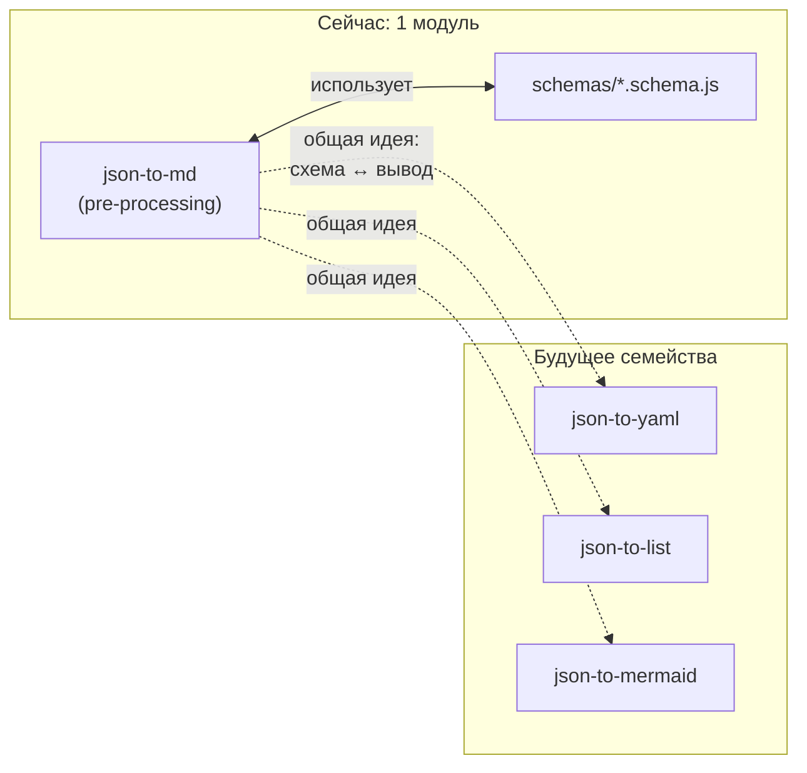

### JSON-генераторы (`json-generators`) {#fam-json-generators}

Свободное семейство универсальных конвертеров: одна структура JSON — разные Markdown-артефакты. Сейчас в семье 1 модуль (`json-to-md`); по мере появления `json-to-yaml`, `json-to-list`, `json-to-mermaid` — расширяется. Каждый модуль самодостаточен, но все делят одну идею — схема отделена от формата вывода.

Отличие от «Дорожной карты» (семья #6): `roadmap` специализирован (Gantt + таблица, иерархия `группа → модуль → функция`, PlantUML), `json-to-md` универсален — любая схема, любой набор полей, четыре режима вывода. Отличие от «Отчётов» (#12): отчёты — про *корпус документации*, json-генераторы — про *произвольный JSON*.

### Модули

### Схема взаимодействия

У семьи **нет строгих пар** — `json-to-md` работает без клиентской части, без post-обработки, без внешних движков. Внутри модуля есть точки расширения, но это детали реализации одного модуля, а не связь между модулями семьи:

| Точка расширения           | Что определяет                                                | Добавляет                 |
| -------------------------- | ------------------------------------------------------------- | ------------------------- |
| `schemas/<name>.schema.js` | Поля JSON → колонки таблицы, `multi`, `isDetails`, `required` | техписатель / разработчик |
| `lib/generators/<name>.js` | Формат вывода (таблица, treemap, …)                           | разработчик               |
| `lib/args.js`              | CLI-флаги                                                     | разработчик               |

Семья «JSON-генераторы» объединяет **конвертеры данных**, а не **пары модулей** (как `abbrs ↔ abbrs.client`). Поэтому это свободная семья, и в ней допустим «1 модуль сегодня, 5 завтра» без пересборки общей логики.

### Когда семья полезна

- **Читаете `json-to-md` и думаете «а что если у меня YAML?»** — раздел «Расширение» статьи модуля + эта страница: новая схема, без нового модуля.
- **Планируете добавить `json-to-yaml`** — формат семейства задан: свой `run-generation` по образцу `json-to-md`, свой каталог `lib/generators/`, свой набор `schemas/`. Семья — точка входа.
- **Отличаете «мой случай» от roadmap**: roadmap — если данные про *план во времени*; json-to-md — если данные это *плоский список*.