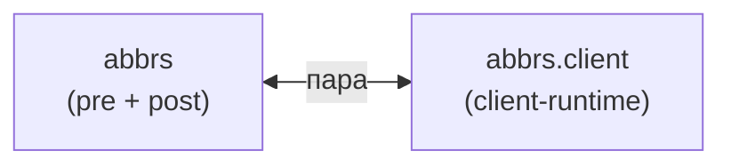

### Аббревиатуры (`abbr`) {#fam-abbr}

Пара «генератор → клиент». `abbrs` (pre) собирает словарь и генерирует указатель, `abbrs.injector` (post) обогащает `<abbr>` тултипами, `abbrs.client` (client) оживляет разметку в браузере. **`abbrs` без `abbrs.client`** — работает (страница-указатель есть), но тултипы не показываются.

### Модули



