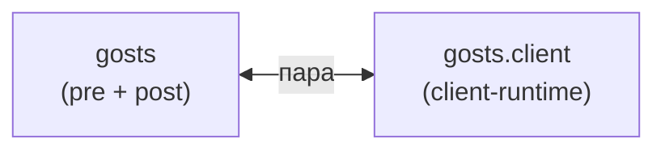

### 4. ГОСТы (`gost`) {#fam-gost}

Третье зеркало — ГОСТы. Отличие: `gosts.client` рисует **таблицу с карточками**, а не тултипы. `abbrs`/`terms` — про inline-разметку, `gosts` — про отдельную страницу.

### Модули



