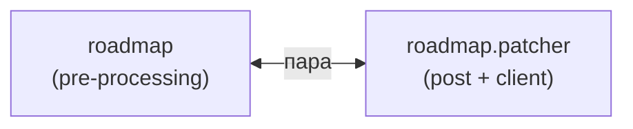

### 6. Дорожная карта (`roadmap` / `gantt`) {#fam-roadmap}

Пара «генератор → патчер». `roadmap` генерирует `roadmap/index.md` с диаграммой Ганта, `roadmap.patcher` встраивает клиентский скрипт для pan/zoom. Без патчера диаграмма статична (видна, но не интерактивна).

### Модули



