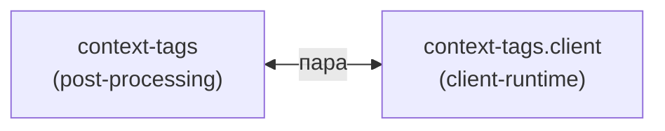

### 5. Контекстные теги (`context-tags`) {#fam-context-tags}

Пара «инжектор → клиент». `context-tags` встраивает `<script>` в каждую статью, `context-tags.client` рисует чипы контекстов. Без клиента — `<script>` есть, чипов нет.

### Модули



