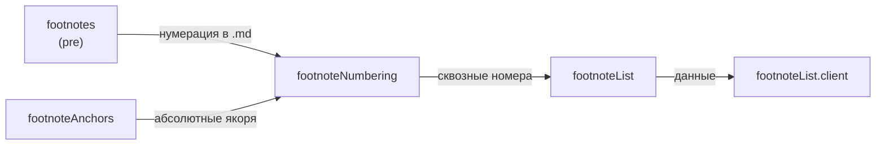

### 7. Сноски (`footnote`) — цепочка из 5 {#fam-footnote}

Самая длинная семья. Не пара, а **цепочка**: `footnotes` (pre) → `footnoteAnchors` (post) → `footnoteNumbering` (post) → `footnoteList` (post) → `footnoteList.client` (client). Каждый следующий шаг опирается на предыдущий.

**Ключевой момент:** `footnoteNumbering` зависит от **двух** предыдущих (`footnotes` + `footnoteAnchors`). Если `--skip=footnoteAnchors`, `footnoteNumbering` всё равно сработает, но якоря не будут абсолютными.

### Модули



