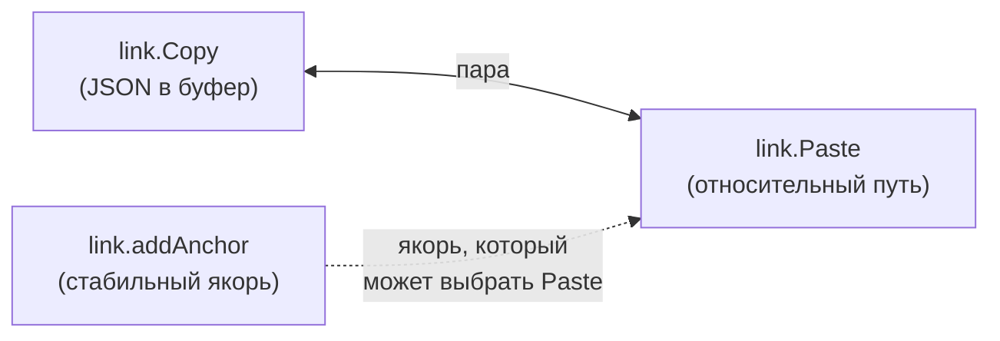

### 1. Ссылки (`link`) {#fam-link}

Пара «скопировать → вставить». `link.Copy` кладёт JSON в буфер, `link.Paste` читает и вставляет с корректным путём. **По отдельности бессмысленны** — JSON в буфере некому прочитать.

`link.addAnchor` — «свободный участник» семьи: создаёт якорь, который `link.Paste` потом предлагает в QuickPick. Но `addAnchor` полезен и сам по себе (если пользователь делает ссылку вручную).

### Модули



