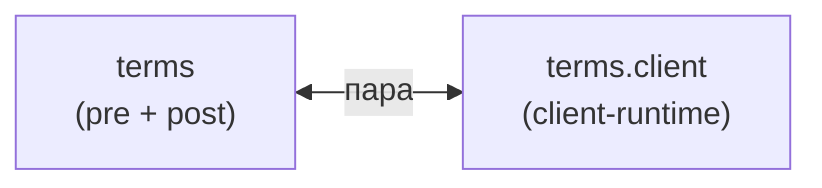

### 3. Термины (`term`) {#fam-term}

Точное зеркало `abbr`: та же структура, другой словарь (`terms.yaml` вместо `abbreviations.yaml`). `<abbr class="term">` — маркер, по которому модули отличают «свой» тег.

### Модули



