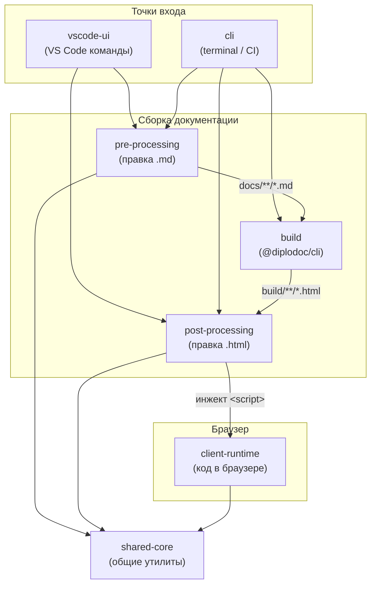

|               |                                                               |
| ------------- | ------------------------------------------------------------- |
| Идентификатор | `modules.layers`                                              |
| layer         | `shared-core`                                                 |
| designation   | 7 слоёв: когда модуль запускается и где он в пайплайне сборки |

{: .page-legend }

## Назначение

**Layer** — это «когда модуль запускается». Не «ради чего» (это `capability`, см. [Каталог](../КаталогCapabilitymap/index.md)), не «с кем в паре» (это `family`, см. [Семейство](../Семействоfamily/index.md)). Именно **место в пайплайне**.

Layer особенно полезен, если вы:

- чините сборку (`docs-build.js`) и не понимаете, в каком порядке что вызывается;
- добавляете новый модуль и не знаете, куда его «приткнуть»;
- настраиваете CI и хотите запустить только часть шагов;
- ищете «что работает в VS Code», «что в браузере», «что только в CLI».

## Пайплайн

7 слоёв, от «точки входа» до «общих утилит». Стрелки — поток данных.

**Ключевая мысль.** Слои — это **время** и **артефакт**, с которым работает модуль. `pre-processing` правит `.md`, `build` превращает в `.html`, `post-processing` правит `.html`, `client-runtime` исполняется в браузере. Между ними — нет пересечений: модуль, который работает в `.md`, **не** сможет править `.html` (и наоборот).

## 7 слоёв

Семь слоёв, от точки входа до «общих утилит». Полное описание каждого — в подразделах ниже.

|     | Слой                                                                                                                                     | Что делает                                  | Модулей      | Когда                             |
| --- | ---------------------------------------------------------------------------------------------------------------------------------------- | ------------------------------------------- | ------------ | --------------------------------- |
| 1   | [VS Code UI](./%D0%A1%D0%BB%D0%BE%D0%B9VSCodeUI/index.md#naznachenie)                                                                    | Команды, диалоги, Diagnostics, Code Actions | 15           | По команде пользователя в VS Code |
| 2   | [CLI](./%D0%A1%D0%BB%D0%BE%D0%B9CLI/index.md#naznachenie)                                                                                | Парсинг `argv`, маршрутизация               | 2            | В терминале, CI                   |
| 3   | [Build](./%D0%A1%D0%BB%D0%BE%D0%B9Build/index.md)                                                                                        | `@diplodoc/cli`, `esbuild`                  | 3            | Один раз за сборку                |
| 4   | [Pre-processing](./%D0%A1%D0%BB%D0%BE%D0%B9Preprocessing/index.md#naznachenie)                                                           | Правка `docs/**/*.md` и `docs/**/*.yaml`    | 19           | До сборки                         |
| 5   | [Post-processing](./%D0%A1%D0%BB%D0%BE%D0%B9Postprocessing/index.md#naznachenie)                                                         | Правка `build/**/*.html`                    | 14           | После сборки                      |
| 6   | [Клиентский runtime](./%D0%A1%D0%BB%D0%BE%D0%B9%D0%9A%D0%BB%D0%B8%D0%B5%D0%BD%D1%82%D1%81%D0%BA%D0%B8%D0%B9runtime/index.md#naznachenie) | Код в браузере                              | 9            | При открытии HTML читателем       |
| 7   | [Общее ядро](./%D0%A1%D0%BB%D0%BE%D0%B9%D0%9E%D0%B1%D1%89%D0%B5%D0%B5%D1%8F%D0%B4%D1%80%D0%BE/index.md#naznachenie)                      | Утилиты, модели, парсеры                    | (библиотека) | Всегда, из других слоёв           |
 
**Колонка «Модулей»** — количество модулей, у которых **этот слой указан первым** в легенде-таблице. Модули с двумя слоями (например, `gosts` — `pre` + `post`) считаются в **каждом** слое, поэтому сумма по столбцу больше 50.

## Многослойные модули

Часть модулей работает в **двух** слоях. Это норма — модуль «генератор + инжектор» или «сервер + клиент».

| Модуль                                       | Слои            | Почему                                               |
| -------------------------------------------- | --------------- | ---------------------------------------------------- |
| `gosts`                                      | pre + post      | Генератор страницы (pre) + инжектор таблицы (post)   |
| `abbrs`                                      | pre + post      | Генератор указателя (pre) + инжектор тултипов (post) |
| `terms`                                      | pre + post      | То же                                                |
| `roadmap` / `roadmap.patcher`                | pre / post      | Два **разных** модуля, связанных парой               |
| `contexts` / `context-search.client`         | pre / client    | Два **разных** модуля                                |
| `bytescounter` / `contextmap` / `helptagmap` | post / client   | Генератор HTML + клиентский `core-renderer`          |
| `tocCleanMode`                               | post + client   | Инжектор + клиентский скрипт                         |
| `section.Create/Delete/Move/Rename`          | vscode-ui / pre | Команда + правка `.md`                               |
| `file.Delete`                                | pre + vscode-ui | То же                                                |
| `docs-build`                                 | cli + build     | Вызов `@diplodoc/cli`                                |

## Как пользоваться

**«Что запускается первым при сборке?»** — [Слой. Pre-processing](./%D0%A1%D0%BB%D0%BE%D0%B9Preprocessing/index.md#naznachenie). В `docs-build.js` — 13 шагов по порядку.

**«Что работает в VS Code?»** — [Слой. VS Code UI](./%D0%A1%D0%BB%D0%BE%D0%B9VSCodeUI/index.md#naznachenie). Все команды, доступные пользователю.

**«Почему у меня не работает clean mode?»** — [Слой. Post-processing](./%D0%A1%D0%BB%D0%BE%D0%B9Postprocessing/index.md#naznachenie). И `tocCleanMode` в `docs-build.js` в **pre**-фазе — известный баг (см. [Модуль Оркестратор сборки](../%D0%A0%D0%B5%D0%B5%D1%81%D1%82%D1%80/%D0%9C%D0%BE%D0%B4%D1%83%D0%BB%D1%8C%D0%9E%D1%80%D0%BA%D0%B5%D1%81%D1%82%D1%80%D0%B0%D1%82%D0%BE%D1%80%D1%81%D0%B1%D0%BE%D1%80%D0%BA%D0%B8/index.md)).

**«Что исполняется в браузере?»** — [Слой. Клиентский runtime](./%D0%A1%D0%BB%D0%BE%D0%B9%D0%9A%D0%BB%D0%B8%D0%B5%D0%BD%D1%82%D1%81%D0%BA%D0%B8%D0%B9runtime/index.md#naznachenie). Список всех клиентских скриптов.

## См. также

- [Модули](../index.md) — точка входа в раздел.
- [Каталог (Capability map)](../КаталогCapabilitymap/index.md) — 11 capability.
- [Семейство (family)](../Семействоfamily/index.md) — модули в парах.
- [Реестр модулей](../Реестр/index.html#naznachenie) — плоский список.