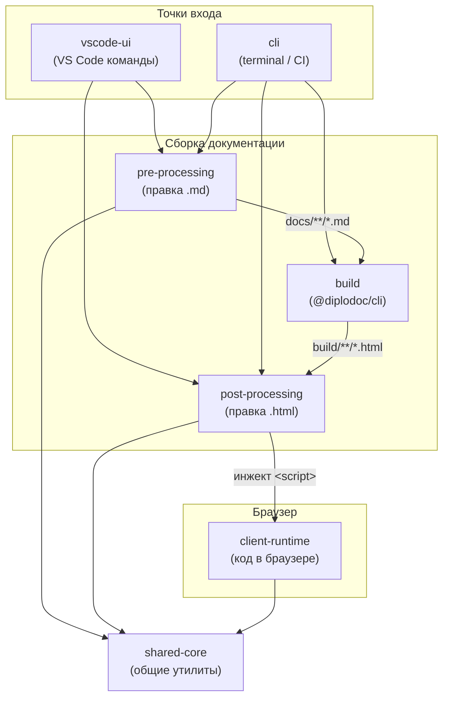

|               |                                                               |
| ------------- | ------------------------------------------------------------- |
| Идентификатор | `modules.layers`                                              |
| Слой          | shared-core                                                   |
| Назначение    | 7 слоёв: когда модуль запускается и где он в пайплайне сборки |

{: .page-legend }

## Назначение

**Layer** — это «когда модуль запускается». Не «ради чего» (это `capability`, см. [Каталог](../КаталогCapabilitymap/index.md)), не «с кем в паре» (это `family`, см. [Семейство](../Семействоfamily/index.md)). Именно **место в пайплайне**.

Layer особенно полезен, если вы:

- чините сборку (`docs-build.js`) и не понимаете, в каком порядке что вызывается;
- добавляете новый модуль и не знаете, куда его «приткнуть»;
- настраиваете CI и хотите запустить только часть шагов;
- ищете «что работает в VS Code», «что в браузере», «что только в CLI».

## Пайплайн

7 слоёв, от «точки входа» до «общих утилит». Стрелки — поток данных.

**Ключевая мысль.** Слои — это **время** и **артефакт**, с которым работает модуль. `pre-processing` правит `.md`, `build` превращает в `.html`, `post-processing` правит `.html`, `client-runtime` исполняется в браузере. Между ними — нет пересечений: модуль, который работает в `.md`, **не** сможет править `.html` (и наоборот).

## 7 слоёв

Семь слоёв, от точки входа до «общих утилит». Полное описание каждого — в подразделах ниже.

|     | Слой                                  | Что делает                                  | Модулей      | Когда                             |
| --- | ------------------------------------- | ------------------------------------------- | ------------ | --------------------------------- |
| 1   | [`vscode-ui`](#vscode-ui)             | Команды, диалоги, Diagnostics, Code Actions | 15           | По команде пользователя в VS Code |
| 2   | [`cli`](#cli)                         | Парсинг `argv`, маршрутизация               | 2            | В терминале, CI                   |
| 3   | [`build`](#build)                     | `@diplodoc/cli`, `esbuild`                  | 3            | Один раз за сборку                |
| 4   | [`pre-processing`](#pre-processing)   | Правка `docs/**/*.md` и `docs/**/*.yaml`    | 19           | До сборки                         |
| 5   | [`post-processing`](#post-processing) | Правка `build/**/*.html`                    | 14           | После сборки                      |
| 6   | [`client-runtime`](#client-runtime)   | Код в браузере                              | 9            | При открытии HTML читателем       |
| 7   | [`shared-core`](#shared-core)         | Утилиты, модели, парсеры                    | (библиотека) | Всегда, из других слоёв           |
 
**Колонка «Модулей»** — количество модулей, у которых **этот слой указан первым** в легенде-таблице. Модули с двумя слоями (например, `gosts` — `pre` + `post`) считаются в **каждом** слое, поэтому сумма по столбцу больше 50.

### `vscode-ui` {#vscode-ui}

**Когда:** при активном VS Code, по команде пользователя.

**Что:** команды из палитры и контекстного меню, диалоги (`InputBox`, `QuickPick`), Diagnostics, Code Actions. Логики — минимум: принимает `Uri` и состояние редактора, делегирует в `pre-processing` или `post-processing`.

**Характерные черты:** использует `vscode.*` API, работает с активным редактором, не пишет файлы напрямую (только через другие модули).

**Модули** (14):

| ID                                                                  | Модуль                     | Что                     |
| ------------------------------------------------------------------- | -------------------------- | ----------------------- |
| [1.1-023](../МодульСозданиесекции/index.md#naznachenie)             | `section.Create`           | Создать секцию          |
| [1.1-024](../МодульУдалениесекции/index.md#naznachenie)             | `section.Delete`           | Удалить секцию          |
| [1.1-025](../МодульПеремещениесекции/index.md#naznachenie)          | `section.Move`             | Переместить секцию      |
| [1.1-026](../МодульПереименованиесекции/index.md#naznachenie)       | `section.Rename`           | Переименовать секцию    |
| [1.2-039](../МодульУдалениефайла/index.md#naznachenie)              | `file.Delete`              | Удалить файл            |
| [1.2-040](../МодульУмноеудаление/index.md#naznachenie)              | `smart.delete`             | Удалить (маршрутизация) |
| [2.2-027](../МодульКопированиессылки/index.md#naznachenie)          | `link.Copy`                | Скопировать ссылку      |
| [2.2-029](../МодульВставкассылки/index.md#naznachenie)              | `link.Paste`               | Вставить ссылку         |
| [2.1-028](../МодульДобавлениеякоря/index.md#naznachenie)            | `link.addAnchor`           | Поставить якорь         |
| [2.2-030](../МодульВставкаизображенияизбуфера/index.md#naznachenie) | `image.PasteFromClipboard` | Вставить из буфера      |
| [2.2-031](../МодульВставкаизображенияизсписка/index.md#naznachenie) | `image.PasteFromList`      | Вставить из списка      |
| [7.1-019](../МодульЛинтерссылок/index.md#naznachenie)               | `linter.links`             | Проверить ссылки        |
| [7.1-020](../МодульЛинтераббревиатур/index.md#naznachenie)          | `linter.abbrs`             | Проверить сокращения    |
| [7.1-021](../МодульЛинтертерминов/index.md#naznachenie)             | `linter.terms`             | Проверить термины       |
| [6.2-049](../МодульInstaller/index.md#naznachenie)                  | `installer`                | Установить скрипты      |

### `cli` {#cli}

**Когда:** в терминале, из CI, из `npm run`. Без VS Code.

**Что:** парсит `argv`, маршрутизирует на модули `pre-processing` или `post-processing`. Не содержит логики.

**Характерные черты:** работает через `node`, не использует `vscode.*`, имеет код возврата.

**Модули** (2):

| ID                                                         | Модуль                | Что                |
| ---------------------------------------------------------- | --------------------- | ------------------ |
| [6.2-046](../МодульCLI/index.md#naznachenie)               | `diplodoc-helper-cli` | 24 подкоманды      |
| [6.2-047](../МодульОркестраторсборки/index.md#naznachenie) | `docs-build`          | Оркестратор сборки |

### `build` {#build}

**Когда:** между `pre-processing` и `post-processing`. Один раз за сборку.

**Что:** превращает `docs/` в `build/`. Собственного кода почти нет — вызывает `@diplodoc/cli` (внешний пакет).

**Характерные черты:** сюда нельзя «добавить модуль» — это внешний процесс. Но **порядок** в `docs-build` (`--apply-presets internal`, `--allow-custom-resources`) — тоже часть слоя.

**Модули** (3, из них 1 внешний):

| ID                                                         | Модуль          | Что                                             |
| ---------------------------------------------------------- | --------------- | ----------------------------------------------- |
| [6.2-047](../МодульОркестраторсборки/index.md#naznachenie) | `docs-build`    | Оркестратор (здесь — вызов `npx @diplodoc/cli`) |
| [6.2-050](../МодульСборкарасширения/index.md#naznachenie)  | `build.js`      | **Не про документацию** — esbuild расширения    |
| —                                                          | `@diplodoc/cli` | Внешний пакет, не модуль расширения             |

### `pre-processing` {#pre-processing}

**Когда:** до `@diplodoc/cli`. Работает с `docs/**/*.md` и `docs/**/*.yaml`.

**Что:** переиндексация, генерация служебных страниц, пересчёт номеров. Результат — структура, из которой `build` может собрать HTML.

**Характерные черты:** пишет в `docs/`, не пишет в `build/`. Идемпотентна (повторный запуск не ломает).

**Модули** (17):

| ID                                                              | Модуль                  | Что                      |
| --------------------------------------------------------------- | ----------------------- | ------------------------ |
| [1.1-022](../МодульЯдросекций/index.md#naznachenie)             | `sections.core`         | Библиотека для секций    |
| [1.1-023](../МодульСозданиесекции/index.md#naznachenie)         | `section.Create`        | Создать секцию           |
| [1.1-024](../МодульУдалениесекции/index.md#naznachenie)         | `section.Delete`        | Удалить секцию           |
| [1.1-025](../МодульПеремещениесекции/index.md#naznachenie)      | `section.Move`          | Переместить секцию       |
| [1.1-026](../МодульПереименованиесекции/index.md#naznachenie)   | `section.Rename`        | Переименовать секцию     |
| [1.2-039](../МодульУдалениефайла/index.md#naznachenie)          | `file.Delete`           | Удалить файл             |
| [1.2-041](../МодульПереиндексацияпапок/index.md#naznachenie)    | `reindexer.directories` | Переиндексация           |
| [1.2-043](../МодульПереиндексациястатей/index.md#naznachenie)   | `reindexer.md`          | Следующий `sectionIndex` |
| [1.2-042](../МодульПереиндексациярисунков/index.md#naznachenie) | `reindexer.figures`     | Нумерация рисунков       |
| [2.2-007](../МодульИллюстрации/index.md#naznachenie)            | `figures`               | Каталог иллюстраций      |
| [3.2-011](../МодульСноски/index.md#naznachenie)                 | `footnotes`             | Нумерация сносок         |
| [8.2-008](../МодульКартапомощи/index.md#naznachenie)            | `helpMap`               | `app-help-contents.json` |
| [3.2-009](../МодульКонтексты/index.md#naznachenie)              | `contexts`              | Страница контекстов      |
| [3.2-010](../МодульСправочныетеги/index.md#naznachenie)         | `helptags`              | Страница helptags        |
| [3.2-003](../МодульАббревиатуры/index.md#naznachenie)           | `abbrs`                 | Словарь сокращений       |
| [3.2-005](../МодульТермины/index.md#naznachenie)                | `terms`                 | Словарь терминов         |
| [3.1-002](../МодульГОСТы/index.md#naznachenie)                  | `gosts`                 | Словарь ГОСТов           |
| [8.2-018](../МодульСтатистикапресетов/index.md#naznachenie)     | `presetsStat`           | `presets.yaml`           |
| [8.2-032](../МодульДорожнаякарта/index.md#naznachenie)          | `roadmap`               | Диаграмма Ганта          |

### `post-processing` {#post-processing}

**Когда:** после `@diplodoc/cli`. Работает с `build/**/*.html`.

**Что:** инжект клиентских скриптов, фикс якорей, сквозная нумерация, хлебные крошки.

**Характерные черты:** пишет в `build/`, не пишет в `docs/`. Идемпотентна (в идеале — в реальности у `tocCleanMode` и `context-tags` бывают дубли).

**Модули** (14):

| ID                                                               | Модуль              | Что                   |
| ---------------------------------------------------------------- | ------------------- | --------------------- |
| [4.2-001](../МодульХлебныекрошки/index.md#naznachenie)           | `breadcrumb`        | Хлебные крошки        |
| [4.2-012](../МодульЯкорясносок/index.md#naznachenie)             | `footnoteAnchors`   | Абсолютные якоря      |
| [4.2-013](../МодульСквознаянумерациясносок/index.md#naznachenie) | `footnoteNumbering` | Сквозная нумерация    |
| [4.2-014](../МодульПереченьсносок/index.md#naznachenie)          | `footnoteList`      | Перечень сносок       |
| [3.1-002](../МодульГОСТы/index.md#naznachenie)                   | `gosts`             | Инжект таблицы ГОСТов |
| [3.2-003](../МодульАббревиатуры/index.md#naznachenie)            | `abbrs`             | Инжект тултипов       |
| [3.2-005](../МодульТермины/index.md#naznachenie)                 | `terms`             | Инжект тултипов       |
| [4.2-045](../МодульКонтекстныетеги/index.md#naznachenie)         | `context-tags`      | Теги контекстов       |
| [4.2-015](../МодульРазмерыстатей/index.md#naznachenie)           | `bytescounter`      | Отчёт «Размеры»       |
| [4.2-016](../МодульКартаконтекстов/index.md#naznachenie)         | `contextmap`        | Отчёт «Контексты»     |
| [4.2-017](../МодульКартасправочныхтегов/index.md#naznachenie)    | `helptagmap`        | Отчёт «Helptags»      |
| [4.2-033](../МодульПатчерГанта/index.md#naznachenie)             | `roadmap.patcher`   | Pan/zoom Ганта        |
| [4.2-044](../МодульРежимбезнавигации/index.md#naznachenie)       | `tocCleanMode`      | Скрипт clean mode     |

### `client-runtime` {#client-runtime}

**Когда:** в браузере читателя, при открытии `build/**/*.html`.

**Что:** интерактив (сворачивание, поиск, тултипы, pan/zoom), достраивание того, что нельзя статически.

**Характерные черты:** не имеет доступа к `fs`, не может «сохранить» что-то — только отобразить.

**Модули** (9):

| ID                                                                   | Модуль                  | Что                   |
| -------------------------------------------------------------------- | ----------------------- | --------------------- |
| [3.2-004](../МодульАббревиатурыКлиент/index.md#naznachenie)          | `abbrs.client`          | Тултипы сокращений    |
| [3.2-006](../МодульТерминыКлиент/index.md#naznachenie)               | `terms.client`          | Тултипы терминов      |
| [5.1-035](../МодульКлиентГОСТов/index.md#naznachenie)                | `gosts.client`          | Таблица ГОСТов        |
| [5.1-036](../МодульКлиентперечнясносок/index.md#naznachenie)         | `footnoteList.client`   | Таблица сносок        |
| [5.1-034](../МодульКлиентскийпоискпоконтекстам/index.md#naznachenie) | `context-search.client` | Поиск по контекстам   |
| [5.1-038](../МодульКлиентконтекстныхтегов/index.md#naznachenie)      | `context-tags.client`   | Чипы контекстов       |
| [5.2-037](../МодульОбщийрендерер/index.md#naznachenie)               | `core-renderer`         | Рендерер трёх отчётов |
| [4.2-033](../МодульПатчерГанта/index.md#naznachenie)                 | `roadmap.patcher`       | Клиентская часть      |
| [4.2-044](../МодульРежимбезнавигации/index.md#naznachenie)           | `tocCleanMode`          | Клиентская часть      |

### `shared-core` {#shared-core}

**Когда:** всегда, когда что-то работает.

**Что:** общие утилиты, модели, парсеры. Нет собственной точки входа, только импорт.

**Характерные черты:** если в `shared-core` появляется код, знающий про конкретный модуль (`breadcrumb`, `gosts`), — это ошибка слоя.

**Модули:** в этот раздел попадают только технические статьи:

| ID  | Модуль            | Что                                                                                                     |
| --- | ----------------- | ------------------------------------------------------------------------------------------------------- |
| —   | `utils/*`         | `path.directory`, `frontmatter.utils`, `yaml.*`, `md.index.*`, `encoding.slugify`, `walk`, `html.utils` |
| —   | `model/*`         | `frontmatter.model`, `section.model`, `frontmatter.templates`                                           |
| —   | `shared/parser/*` | `mdLinks`                                                                                               |

Отдельных статей **нет** (это «библиотека», не модули). Но их функции упоминаются в «Связях» каждой статьи, которая их использует.

## Многослойные модули

Часть модулей работает в **двух** слоях. Это норма — модуль «генератор + инжектор» или «сервер + клиент».

| Модуль                                       | Слои            | Почему                                               |
| -------------------------------------------- | --------------- | ---------------------------------------------------- |
| `gosts`                                      | pre + post      | Генератор страницы (pre) + инжектор таблицы (post)   |
| `abbrs`                                      | pre + post      | Генератор указателя (pre) + инжектор тултипов (post) |
| `terms`                                      | pre + post      | То же                                                |
| `roadmap` / `roadmap.patcher`                | pre / post      | Два **разных** модуля, связанных парой               |
| `contexts` / `context-search.client`         | pre / client    | Два **разных** модуля                                |
| `bytescounter` / `contextmap` / `helptagmap` | post / client   | Генератор HTML + клиентский `core-renderer`          |
| `tocCleanMode`                               | post + client   | Инжектор + клиентский скрипт                         |
| `section.Create/Delete/Move/Rename`          | vscode-ui / pre | Команда + правка `.md`                               |
| `file.Delete`                                | pre + vscode-ui | То же                                                |
| `docs-build`                                 | cli + build     | Вызов `@diplodoc/cli`                                |

## Как пользоваться

**«Что запускается первым при сборке?»** — [pre-processing](#pre-processing). В `docs-build.js` — 13 шагов по порядку.

**«Что работает в VS Code?»** — [vscode-ui](#vscode-ui). Все команды, доступные пользователю.

**«Почему у меня не работает clean mode?»** — [post-processing](#post-processing). И `tocCleanMode` в `docs-build.js` в **pre**-фазе — известный баг (см. [Модуль Оркестратор сборки](../МодульОркестраторсборки/index.md)).

**«Что исполняется в браузере?»** — [client-runtime](#client-runtime). Список всех клиентских скриптов.

## См. также

- [Модули](../index.md) — точка входа в раздел.
- [Каталог (Capability map)](../КаталогCapabilitymap/index.md) — 11 capability.
- [Семейство (family)](../Семействоfamily/index.md) — модули в парах.
- [Реестр модулей](../Реестр/index.html#naznachenie) — плоский список.