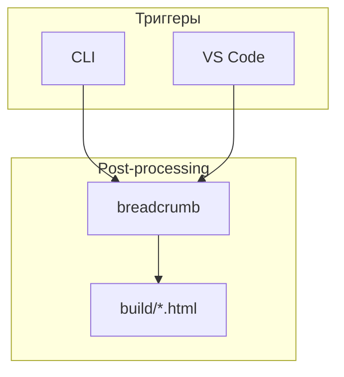

|               |                                                                       |
| ------------- | --------------------------------------------------------------------- |
| Идентификатор | `conventions`                                                         |
| layer         | `shared-core`                                                         |
| designation   | Фиксирует формат статей о модулях, правила идентификации и оформления |

{: .page-legend }

## Область применения

Документ описывает, **как пишется** статья о модуле: структура, обязательные и опциональные разделы, правила идентификации, оформление таблиц и диаграмм. Он не заменяет конкретные статьи — только задаёт рамку.

Документ адресован:

- **авторам** — чтобы статьи были предсказуемыми;
- **читателям** — чтобы понимать, что и где искать;
- **сборке** — чтобы контексты, реестр ID и оформление работали консистентно.

## Структура статьи о модуле

Каждая статья о модуле состоит из **обязательных** и **опциональных** разделов. Обязательные — всегда, даже если содержимое короткое. Опциональные — только если есть что сказать; пустых заглушек не оставляем.

## Название статьи модуля

Заголовок статьи о модуле формируется по шаблону:

```text
Модуль. <Локализованное название>
```

Пример: `Модуль. Хлебные крошки` — для `breadcrumb` (`4.2-001`).

Слово «Модуль» в начале — визуальный маркер: в дереве навигации статьи о модулях нужно мгновенно отделять от прочих материалов (соглашений, слоёв, сценариев). Без префикса «Breadcrumb» и «Соглашения» выглядят как соседи одного ряда, хотя у них разная природа.

Техническое (короткое) имя — идентификатор модуля — в заголовок **не попадает**: оно живёт в легенде-таблице. Читатель в заголовке видит, «что это за штука», а в легенде — «как её зовут в коде».

### Обязательные разделы

| Раздел                            | Назначение                                                 |
| --------------------------------- | ---------------------------------------------------------- |
| Легенда (таблица «ключ-значение») | Идентификация модуля одним взглядом                        |
| Назначение                        | Зачем модуль существует                                    |
| Связи                             | Прозаическая часть — сохраняется при standalone-публикации |

### Опциональные разделы

| Раздел                | Когда добавлять                                            |
| --------------------- | ---------------------------------------------------------- |
| Как это работает      | Модуль нетривиален (несколько фаз, файлов, потоков данных) |
| Режимы работы         | У модуля есть точка входа в VS Code, CLI или пайплайне     |
| Юнит-тесты            | В репозитории есть `test/**/*.test.js` для модуля          |
| Известные ограничения | Есть задокументированные подводные камни                   |

### Скелет

```md
---
title: <идентификатор модуля>
sectionType: Page
context: <идентификатор>, <слой>, <артефакт>
---

|               |                                                                                                                  |
| ------------- | ---------------------------------------------------------------------------------------------------------------- |
| ID            | `<G>.<T>-<XXX>`                                                                                                  |
| Идентификатор | `<идентификатор>`                                                                                                |
| pureTitle     | <человеческое имя>                                                                                               |
| layer         | <`pre-processing` | `post-processing` | `client-runtime` | `vscode-ui` | `cli` | `build` | `shared-core`>        |
| folder        | `src/plugins/<модуль>/`                                                                                          |
| entrypoint    | `<функция>(<аргументы>)`                                                                                         |
| Версия        | `<версия>`                                                                                                       |
| designation   | <одна строка — что делает>                                                                                       |

{: .page-legend }

## Назначение

Проза. Один-два абзаца: что делает, зачем, какую проблему решает.

## Как это работает

<опционально>

Поток данных, файлы, ключевые функции. Диаграмма — mermaid.

## Режимы работы

<опционально>

### VS Code

<если есть команды>

### CLI

<если есть>

### Сборочный пайплайн

<если участвует в docs-build.js>

## Юнит-тесты

<если есть>

## Связи

Прозаическая часть — для standalone.

## Известные ограничения

<опционально>
```

## Идентификация модулей

### Формат

```
<G>.<T>-<XXX>
```

где:

- **`<G>`** — группа (1–9), без лидирующего нуля;
- **`<T>`** — тип взаимодействия (1–9), без лидирующего нуля;
- **`<XXX>`** — сквозной порядковый номер (001–999), **не зависит** ни от группы, ни от типа.

Примеры: `4.2-001`, `5.1-004`, `8.2-012`.

Смысл точечной нотации — визуально разделить «смысловую ось» (группа) и «ось взаимодействия» (тип); `XXX` при этом глобальный и неизменный, чтобы по нему можно было сортировать и ссылаться.

### Группы (`<G>`)

| G   | Группа                                | Примеры                                                                                                  |
| --- | ------------------------------------- | -------------------------------------------------------------------------------------------------------- |
| 1   | Структурный YAML — управление статьёй | `sections`, `reindexer`, `manifest`                                                                      |
| 2   | Внешний объект (ссылка, картинка)     | `link`, `image`, `figures`                                                                               |
| 3   | Структурный MD (сноска, контекст, …)  | `footnotes`, `contexts`, `helptags`, `abbrs`, `terms`, `gosts`                                           |
| 4   | Пост-обработка HTML                   | `breadcrumb`, `context-tags`, `tocCleanMode`, `contentNavigator`, `footnoteAnchors`, `footnoteNumbering` |
| 5   | Клиентский runtime                    | `abbrs.client`, `terms.client`, `context-search.client`, `gosts.js`, `footnoteList.js`                   |
| 6   | Сборка / оркестрация                  | `docs-build`, `cli`, `installer`                                                                         |
| 7   | Аналитика / линтер                    | `linter`                                                                                                 |
| 8   | Генераторы артефактов                 | `helpMap`, `roadmap`                                                                                     |

### Типы взаимодействия (`<T>`)

| T   | Тип          | Комментарий                                                     |
| --- | ------------ | --------------------------------------------------------------- |
| 1   | Визуальный   | Есть интерактивный UI (панель, подсказка, действия в редакторе) |
| 2   | Невизуальный | Работает «под капотом»: правит файлы, вставляет скрипты         |
| 3   | Гибридный    | UI + фоновая работа с файлами                                   |

Трактовка «визуальный» — про **наличие интерактивного UI**. Если модуль лишь меняет содержимое HTML и результат видит конечный пользователь в браузере, это всё ещё **невизуальный** — иначе почти всё стало бы «визуальным» и ось потеряла бы смысл.

### Порядковый номер (`<XXX>`) и реестр

- **Сквозной.** Один и тот же счётчик для всех модулей, независимо от группы и типа. Максимум — `999`.
- **Одноразовый.** Один раз выданный ID **не переиспользуется** — ни при переименовании модуля, ни при удалении. Удалённые модули помечаются в реестре как `deprecated`, но запись сохраняется.
- **Не прыгает.** Если модуль переносится в другую группу (меняется природа), ID **не меняется** — меняется только запись в реестре. Идентификатор — это «паспорт», а не «адрес».

Реестр ведётся в [`Модули/_registry.md`](../Модули/_registry.md). Прежде чем заводить новую статью — загляни туда, возьми следующий свободный `XXX` и добавь строку.

### Зарезервированные диапазоны

| Диапазон              | Назначение                                                 |
| --------------------- | ---------------------------------------------------------- |
| `0.0-000` – `0.0-099` | Внутренние/служебные идентификаторы (в т.ч. `conventions`) |
| `1.1-001` – `8.9-899` | Модули                                                     |
| `8.9-900` – `9.9-999` | Архив, эксперименты                                        |

## Легенда-таблица

Первое, что видит читатель — таблица «параметр → значение». Требования: **без заголовка**, **минимальные паддинги**, **без чередующихся полос**, **мелкий шрифт**.

### Разметка

Таблица — обычный MD, шапка пустая, класс цепляется через attr-list:

```markdown
|               |              |
| ------------- | ------------ |
| ID            | `4.2-001`    |
| Идентификатор | `breadcrumb` |
| …             | …            |

{: .page-legend }
```

Ключевые моменты:

- **Шапка пустая** (`| | |`) — таблица «ключ-значение», заголовки колонок не нужны.
- **Attr-list `{: .page-legend }`** — сразу после пустой строки, следующей за таблицей. Требует включённого `markdown.attrs` в конфиге Diplodoc; иначе стиль не прикрепится.
- **Без обёртки `<div>`** — MD-таблица внутри `<div>` на отдельных строках не рендерится.

### CSS

Файл `_assets/styles/page-legend.css` (подключается через `.yfm`):

```css
.page-legend {
    font-size: 0.82rem;
    line-height: 1.35;
    margin: 0.75rem 0 1.5rem;
    border-collapse: collapse;
    width: 100%;
    max-width: 720px;
}

.page-legend thead { display: none; }

.page-legend th,
.page-legend td {
    padding: 0.15rem 0.55rem;
    border: 1px solid #e3e6eb;
    vertical-align: top;
    text-align: left;
}

.page-legend td:first-child {
    font-weight: 600;
    color: #4a5568;
    white-space: nowrap;
    width: 1%;
}

.page-legend tbody tr,
.page-legend tbody tr:nth-child(even),
.page-legend tbody tr:nth-child(odd) {
    background: transparent !important;
}

.page-legend code {
    font-size: 0.78rem;
    padding: 0 0.15rem;
}

.page-legend.table-wrapper { border: none; }
```

Пояснения:

- `thead { display: none }` — визуально без заголовка, но синтаксически MD-таблица (требование `markdown-it`).
- `!important` на `background` — страховка от темы Diplodoc, которая может красить `tr:nth-child(even)`.
- `td:first-child { width: 1%; white-space: nowrap }` — колонка-метка по содержимому, колонка-значение забирает остаток.

## Диаграммы

- **Только mermaid.** PlantUML в статьях не используем, даже если в других схемах модуля он фигурирует: mermaid рендерится клиентом Diplodoc без внешних сервисов.
- **Смысловые блоки — `subgraph`**, не «плоский» граф. Слои и группы — визуально.
- **Диаграммы связей — в ``**, чтобы при standalone-публикации можно было снять одним движением и оставить только прозу.

Пример mermaid-блока:



Обёртка в свёртку — внутрь `` подставляется mermaid-блок:

````markdown


...здесь mermaid-блок...


````

(Тут `` работает — это **родная** директива Diplodoc, в отличие от ``. Warnings не даёт, потому что внутри неё <code>&#123;&#123;</code> нет.)

## Версии

Поле `Версия` в легенде — **единое для всех модулей**, берётся из git/CHANGELOG (стартовая — `1.54.0`). Модули не версионируются по отдельности.

При каждом релизе поле нужно обновлять синхронно во всех статьях. Пока — **вручную**, при следующей итерации автоматизируем. Если ручное обновление начнёт мешать — компромисс: заменяем значение на ссылку `см. CHANGELOG`.

## Оформление текста

| Правило                                                                             | Пример                                          |
| ----------------------------------------------------------------------------------- | ----------------------------------------------- |
| Пути к файлам и каталогам — inline-код                                              | `src/plugins/breadcrumb/`                       |
| Имена функций — inline-код с сигнатурой                                             | `runGeneration(buildDir)`                       |
| Имена команд VS Code — inline-код                                                   | `diplodoc-helper.generateBreadcrumbs`           |
| Имена конфиг-ключей — inline-код                                                    | `diplodoc-helper.usePollingForContext`          |
| Три backtick — для кода в блоках; четыре — если внутри блока есть трёх-backtick-код | см. примеры выше                                |
| Языки кода — явно у fence                                                           | `bash`, `js`, `yaml`, `md`, `mermaid`, `css`    |
| Классы CSS, селекторы — inline-код                                                  | `.dc-doc-page__main`                            |
| Названия модулей в прозе — как есть, без кавычек                                    | «модуль breadcrumb», а не «модуль “breadcrumb”» |


### Экранирование плейсхолдеров

Diplodoc подставляет переменные по шаблону <code>&#123;&#123; &#125;&#125;</code> из `presets.yaml`. Если в статье нужно **показать** плейсхолдер как текст (например, документируя шаблон модуля), приём `` **не работает** — эта директива в текущей версии не поддерживается (рендерится как обычный текст, а содержимое всё равно сканируется на <code>&#123;&#123; &#125;&#125;</code>). `vars: false` в frontmatter тоже не помогает.

Рабочий приём — **HTML-entity**: фигурные скобки кодируются как `&#123;` и `&#125;`. В источнике пары <code>&#123;&#123;</code> нет, warning не срабатывает; в браузере скобки декодируются и отображаются как <code>&#123;&#123; &#125;&#125;</code>:

```text
<code>&#123;&#123;TITLES_MAP&#125;&#125;</code>
```

Рендерится как <code>&#123;&#123;TITLES_MAP&#125;&#125;</code> — в моноширинном стиле, без подстановки.

Несколько плейсхолдеров подряд — каждый оборачивается отдельно:

```text
<code>&#123;&#123;TITLES_MAP&#125;&#125;</code>, <code>&#123;&#123;SEPARATOR&#125;&#125;</code>
```

Для прозы без моноширинного стиля допустим markdown-escape — `\{\{TITLES_MAP\}\}`. Внутри backtick он **не работает** (код не обрабатывает escape-последовательности), поэтому для inline-кода — только HTML-entity.

**Правило:** если в статье встречается <code>&#123;&#123;</code> — заменить на `<code>&#123;&#123;…&#125;&#125;</code>` без исключений.

## Соглашения о путях

- **Статья о модуле** — `docs/ru/Модули/<Module>/index.md`. Имя папки — с заглавной, как имя модуля в человеческой записи (`Breadcrumb`, `Gosts`, `Abbrs`).
- **Реестр модулей** — `docs/ru/Модули/_registry.md`. Ведущий `_` — служебный файл, не для навигации.
- **Мета-статьи** (как эта) — `docs/ru/<Раздел>/index.md`, с заглавной буквы в имени раздела.
- **Языковая папка** — `ru` / `en`. Все статьи — в обеих, если иное не оговорено.

## Что осталось за кадром

Не регламентируется сейчас, но стоит держать в голове:

- **Языковые версии.** Для `en` — та же структура, тот же ID, те же разделы. Переводчики ориентируются на `ru`.
- **Standalone-публикация.** Когда модуль «отпочковывается» как самостоятельный пакет — статья превращается в `README.md` модуля; удаляется `` и разделы, ссылающиеся на другие модули.
- **Ссылки между статьями.** Оформляем относительно (`../Gosts/index.md`), не абсолютно — чтобы работало при переносе.